<p align="center">
  <a href="https://github.com/pmsosa/knwlge"></a>
</p>

<h1 align="center">Knwlge</h1>

<p align="center">
  <b>Name any subject and get a self-paced course: planned, written, marked and kept honest.</b><br>
  <i>Pronounced "knowledge".</i> An AI (Gemini, Claude, OpenAI or a local model, one per kind of work) plans the<br>
  course, writes short lessons with worked examples, pictures and<br>
  practice, gives feedback on your written work and answers your questions. The app checks its work: a second<br>
  read-through for every session, points from the rubric, and reading suggestions looked up before you see them.<br>
  No deadlines, no notifications, no grades or scores: just progress.
</p>

<p align="center">
  
  
  
  
  
  
</p>

<p align="center">
  <a href="https://github.com/pmsosa/knwlge">Project</a> ·
  <a href="wiki/README.md">User guide</a> ·
  <a href="docs/wiki/index.md">Technical wiki</a> ·
  <a href="#quick-start">Quick Start</a> ·
  <a href="#architecture">Architecture</a>
</p>

<p align="center">
  <a href="wiki/studying.md">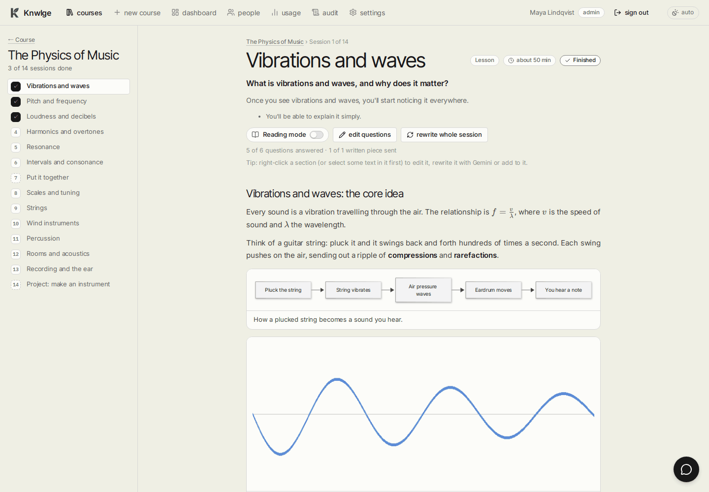</a><br>
  <sub><i>A session: the outline stays put on the left; the lesson, its pictures and its questions scroll in one column.</i></sub>
</p>

<p align="center">
  <a href="#screenshots">Screenshots</a> ·
  <a href="#features">Features</a> ·
  <a href="#requirements">Requirements</a> ·
  <a href="#development">Development</a> ·
  <a href="#configuration">Configuration</a> ·
  <a href="#project-structure">Project Structure</a> ·
  <a href="#license">License</a>
</p>

> [!TIP]
> **New here?** Read the [user guide](wiki/README.md): it walks through a first course with screenshots, from naming
> a subject to finishing a session, plus the tutor, editing and administration. Developers: see the
> [technical wiki](docs/wiki/index.md).

## Screenshots

Taken from a throw-away demo with made-up courses and people (`python -m app.demo`), not from anyone's real learning.

<table>
<tr>
<td width="50%" valign="top">
<a href="wiki/getting-started.md#your-courses-and-the-rest">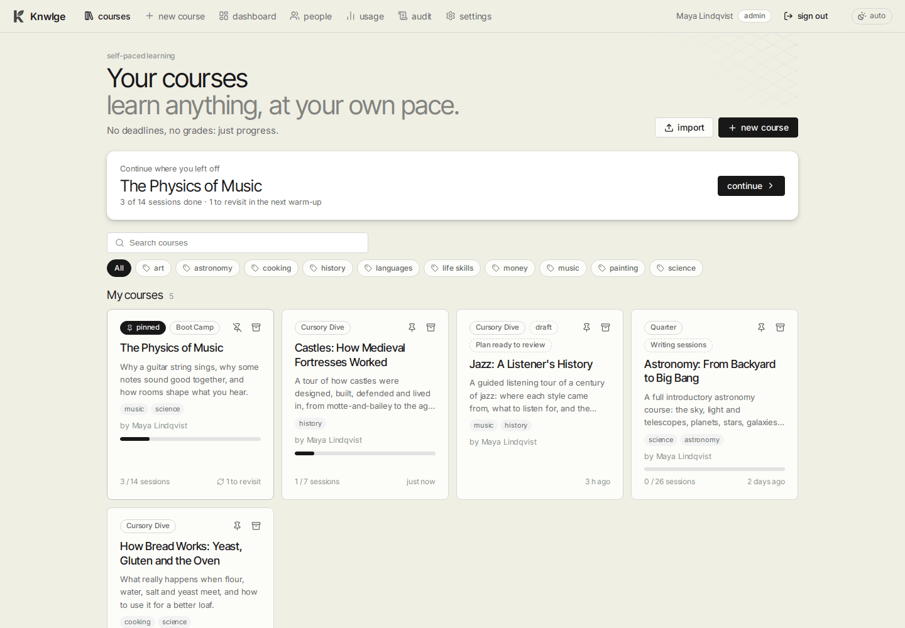</a><br>
<b>Your courses first</b><br>
<sub>The ones you're taking sit on top, pinned ones first; everything else is under Available. Search and filter by tag.</sub>
</td>
<td width="50%" valign="top">
<a href="wiki/making-a-course.md">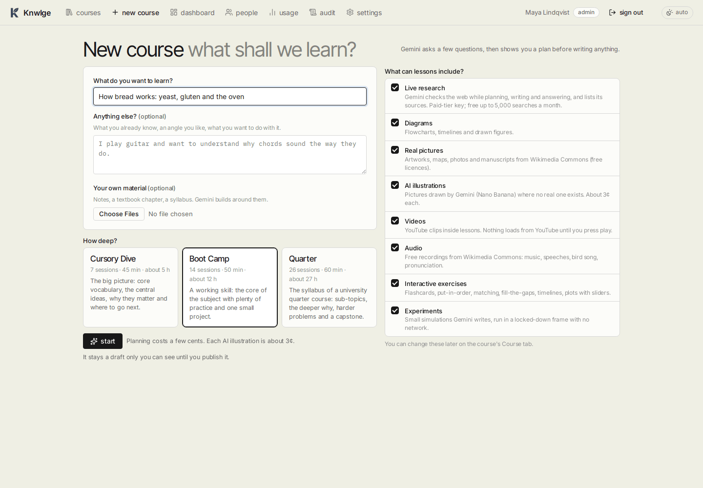</a><br>
<b>New course</b><br>
<sub>Cursory Dive, Boot Camp or Quarter, your own material, and what lessons may include: research, diagrams, pictures, video, audio, exercises, experiments.</sub>
</td>
</tr>
<tr>
<td width="50%" valign="top">
<a href="wiki/making-a-course.md#reviewing-the-plan">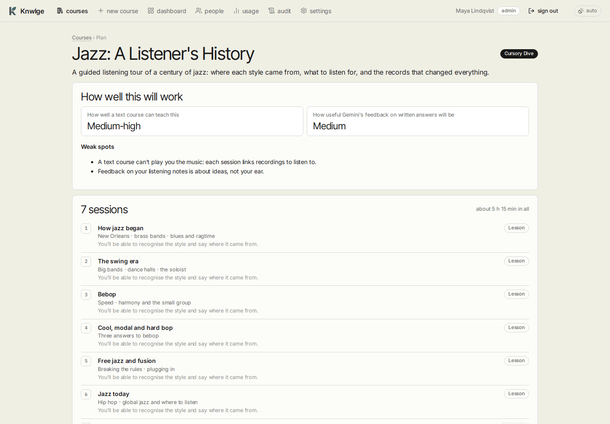</a><br>
<b>Plan review</b><br>
<sub>An honest readiness report, then every session. Approve it, or ask for changes in plain words. Nothing is written until you do.</sub>
</td>
<td width="50%" valign="top">
<a href="wiki/studying.md#interactive-parts">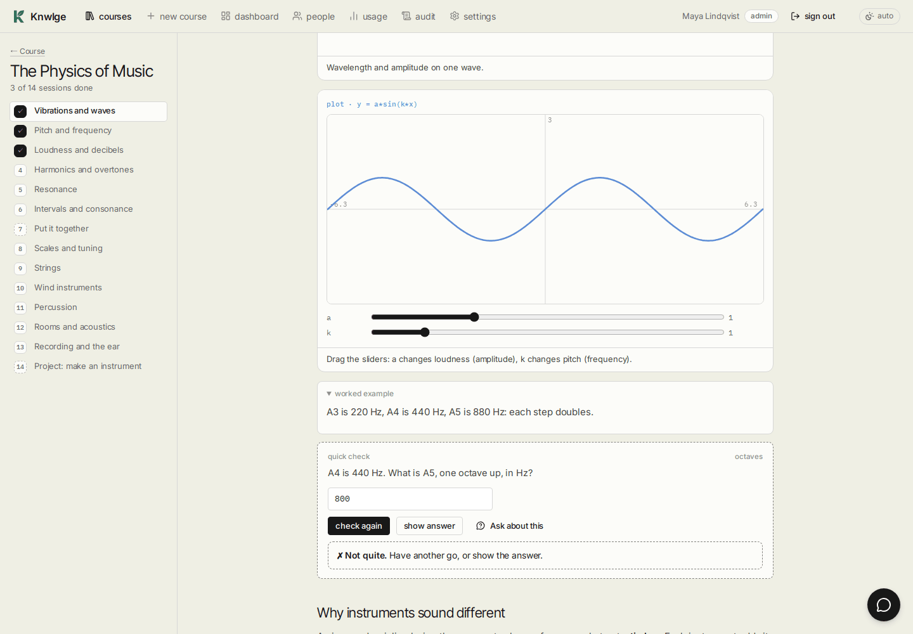</a><br>
<b>Play with it</b><br>
<sub>Plots with sliders, flashcards, put-in-order, matching, fill-the-gaps and timelines, plus quick checks marked on the spot.</sub>
</td>
</tr>
<tr>
<td width="50%" valign="top">
<a href="wiki/studying.md#written-work-and-feedback">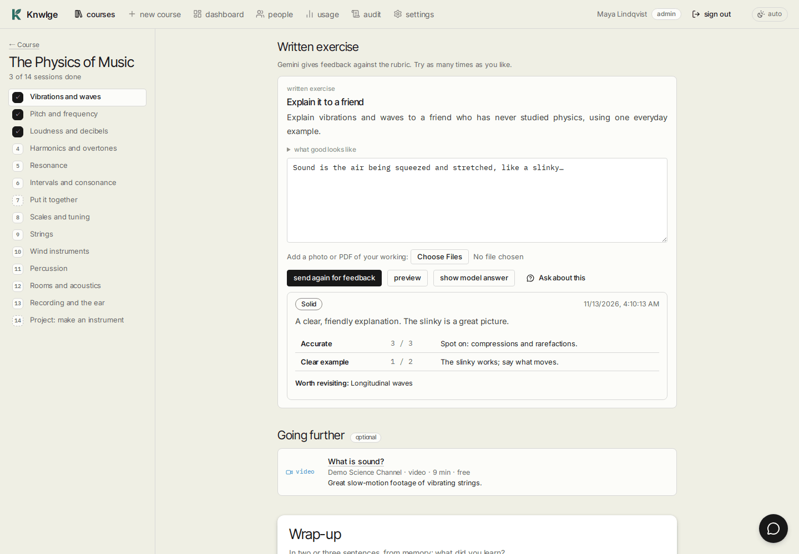</a><br>
<b>Feedback, not a grade</b><br>
<sub>Gemini comments on each rubric line; the app adds up the points. Send it again as often as you like.</sub>
</td>
<td width="50%" valign="top">
<a href="wiki/the-tutor.md">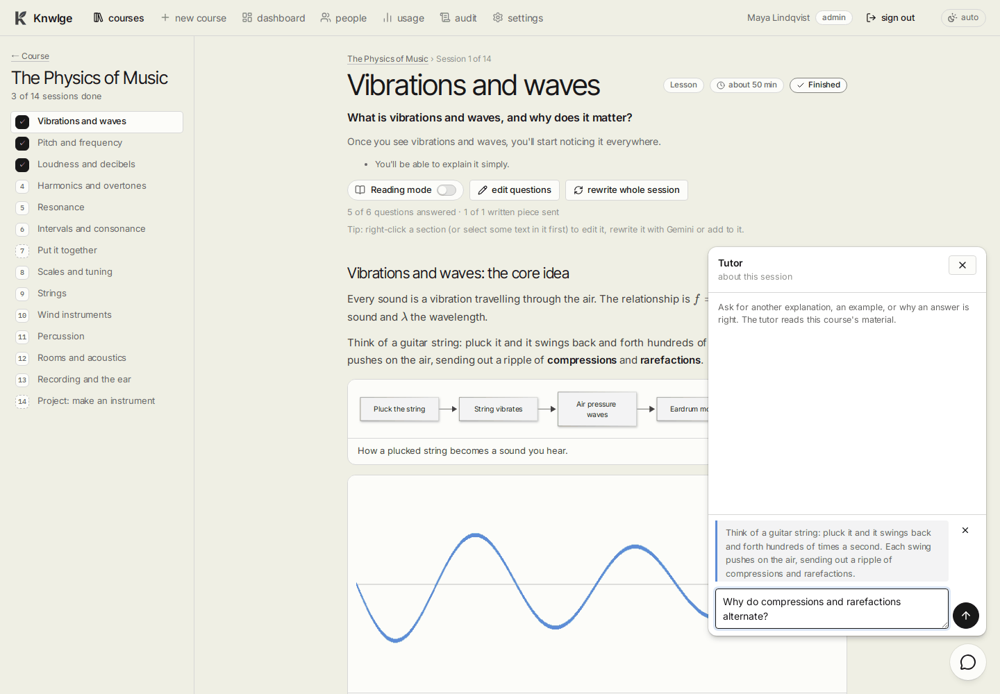</a><br>
<b>A tutor in the corner</b><br>
<sub>Ask about the session, a question, or a passage you selected. It reads the course and your attempt.</sub>
</td>
</tr>
<tr>
<td width="50%" valign="top">
<a href="wiki/editing-courses.md">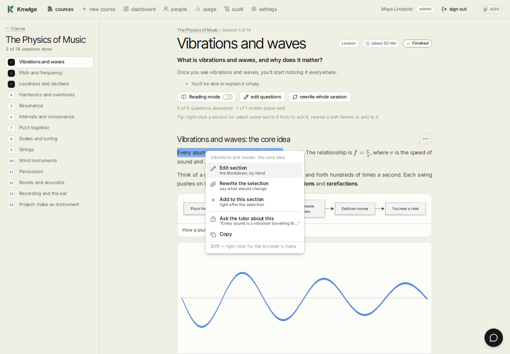</a><br>
<b>Right-click to change it</b><br>
<sub>Edit a section's Markdown by hand, or have Gemini rewrite it or add to it. Only that section changes.</sub>
</td>
<td width="50%" valign="top">
<a href="wiki/studying.md#further-reading">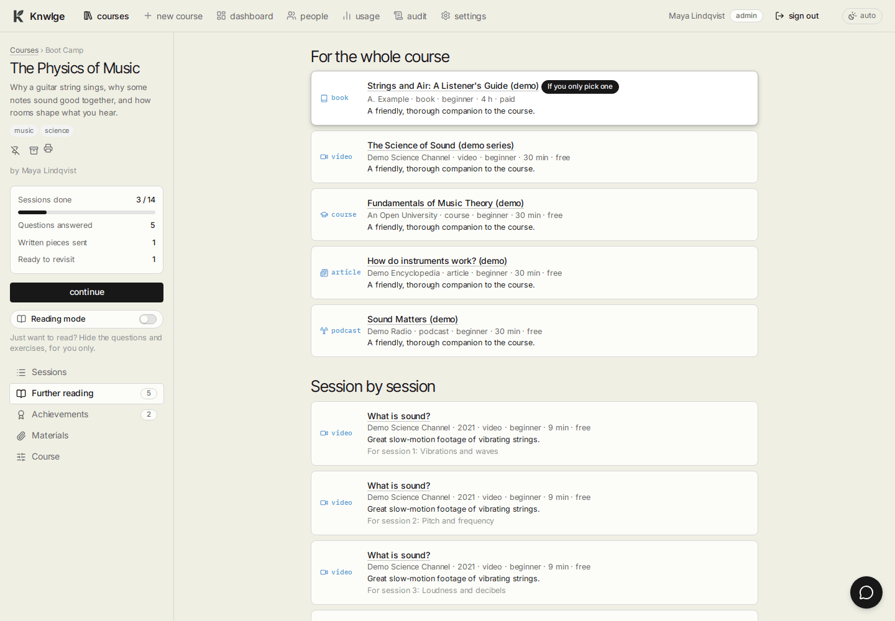</a><br>
<b>Suggestions that really exist</b><br>
<sub>Books are checked on Open Library, videos on YouTube and pages by loading them. Made-up ones are dropped.</sub>
</td>
</tr>
<tr>
<td width="50%" valign="top">
<a href="wiki/studying.md#reading-mode">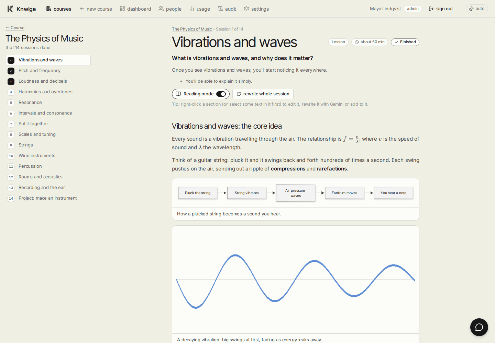</a><br>
<b>Reading mode</b><br>
<sub>Just want to read? Hide the questions, practice and written work, for you only. Switch it off and they're all back.</sub>
</td>
<td width="50%" valign="top">
<a href="wiki/getting-started.md#light-and-dark">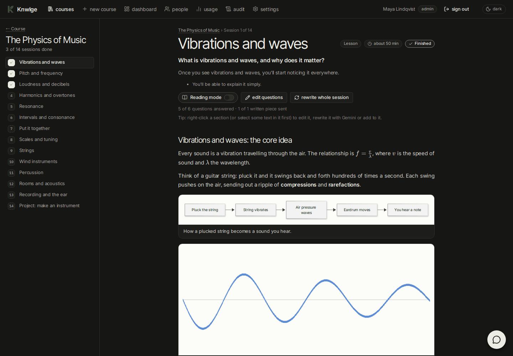</a><br>
<b>Light and dark</b><br>
<sub>A warm paper look by day and a near-black one at night, following your device. Installable as an app.</sub>
</td>
</tr>
<tr>
<td width="50%" valign="top">
<a href="wiki/administration.md#ai-providers">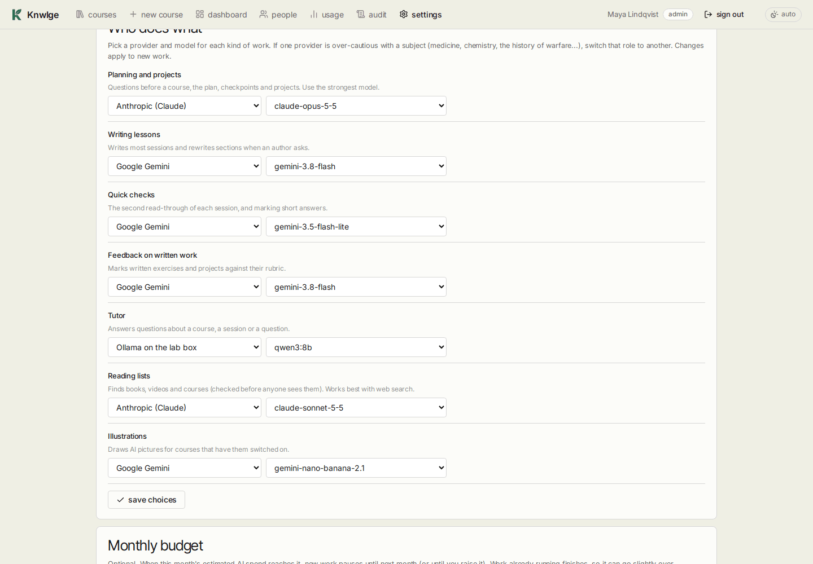</a><br>
<b>Any AI, one per job</b><br>
<sub>Gemini, Claude, OpenAI or a local model through any OpenAI-compatible endpoint. Pick one for planning, one for marking, another for the tutor.</sub>
</td>
<td width="50%" valign="top">
<a href="wiki/administration.md#the-dashboard">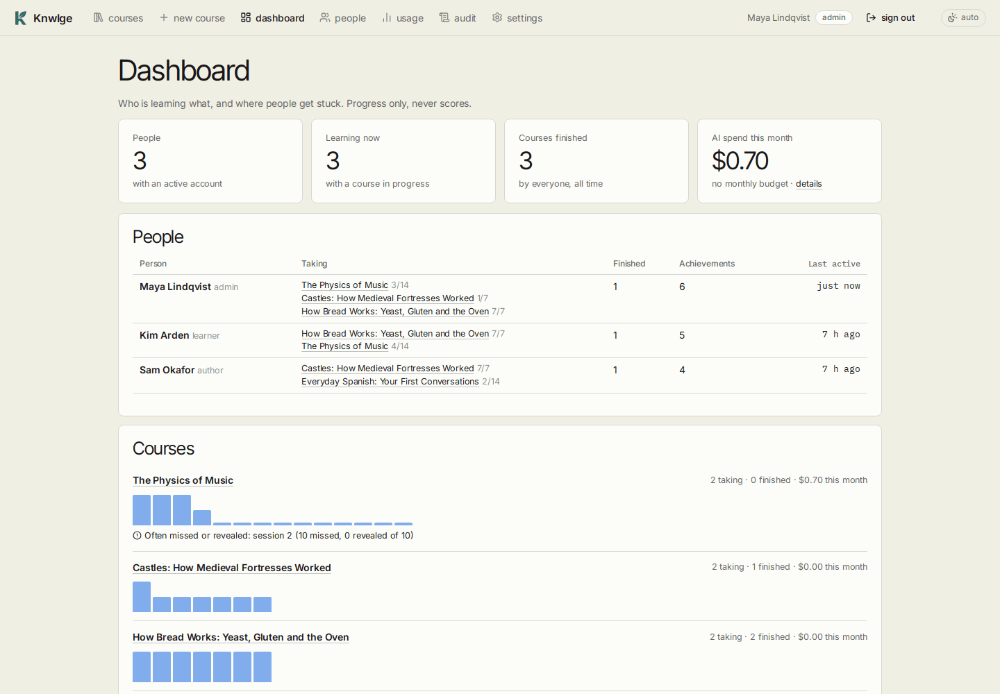</a><br>
<b>See how people are doing</b><br>
<sub>For admins in team mode: who is taking what, how far each course gets, where answers are often missed, and spend by provider.</sub>
</td>
</tr>
<tr>
<td width="50%" valign="top">
<a href="wiki/studying.md#achievements">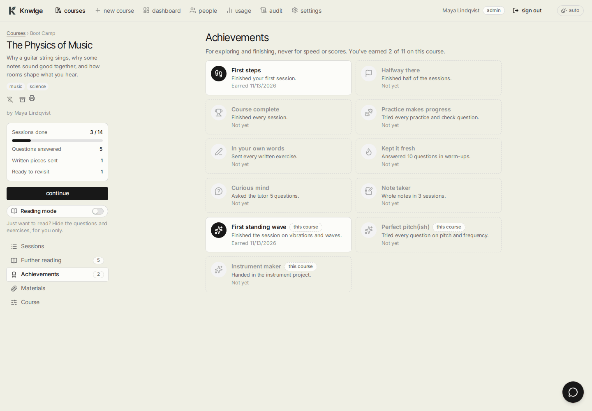</a><br>
<b>Achievements for finishing, never for speed</b><br>
<sub>A built-in set on every course, plus a few themed ones written with the plan. An opt-in feed shares them, if you want.</sub>
</td>
<td width="50%" valign="top">
<a href="wiki/editing-courses.md#printing-and-sharing">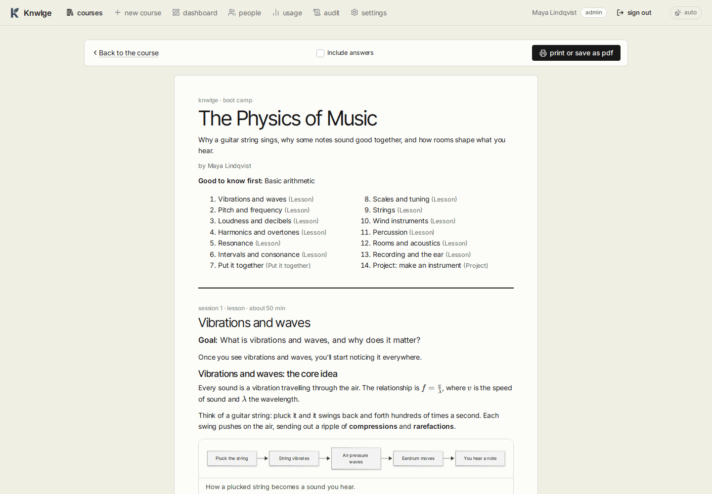</a><br>
<b>Print it, share it</b><br>
<sub>A whole course on one page for Save as PDF, with or without answers. Or a .knwlge package that imports into any Knwlge.</sub>
</td>
</tr>
</table>

## Features

- **Three depths** - Cursory Dive (6 sessions + wrap-up, ~5 h), Boot Camp (12 + checkpoint + project, ~12 h) and Quarter (22 + 2 reviews + checkpoint + capstone, ~27 h, about a university intro course)
- **A plan you approve** - a few questions about you first, then a plan with an honest readiness report (how well a text course can teach this, and its weak spots); change it in plain words
- **Sessions built for remembering, without grades** - warm-ups from earlier sessions (missed ones first, then spaced out), short lesson parts with worked examples and quick checks, practice, a written exercise and a wrap-up from memory
- **Checked as it's written** - the app checks every answer key it can, a second model reads each session through, and sessions with major problems are rewritten
- **Feedback on written work** - per rubric line, with the points added up by the app (each line capped), photos and PDFs of handwritten work accepted
- **Pictures, sound and things to play with** - Mermaid diagrams, freely licensed pictures and recordings from Wikimedia Commons, optional AI illustrations, YouTube videos, six kinds of interactive exercise and sandboxed experiments; all fetched and served by the app
- **Live research (optional)** - Google Search while planning, writing and answering, with the sources listed under each session
- **Verified further reading** - books, videos, courses and podcasts, each one looked up before it's shown
- **Reading mode** - just want to read? Each person can hide the questions, practice, written work and warm-ups on any course; they're still there when you switch it off
- **A tutor** - a chat bubble on every course and session page; ask about the session, a question (it sees your attempt) or a selected passage
- **Edit anything** - right-click a section to edit its Markdown, or have the AI rewrite it or add to it; edit questions; rewrite a whole session
- **Any AI provider, one per role** - Gemini built in; add OpenAI, Anthropic (Claude) or any OpenAI-compatible endpoint (LiteLLM, Ollama, vLLM, LM Studio) and pick a provider and model for planning, writing, checks, marking, the tutor, reading lists and illustrations; keys tested on entry, model lists filled in, prices per provider
- **Your courses first** - the courses you're taking (started, added or pinned) above everything else available, with search and shared tags (suggested with the plan, edited by authors)
- **Share, import and print** - a `.knwlge` package with the whole course (optionally your own progress), an import that treats the file as untrusted, Markdown export, and a print layout for Save as PDF
- **Achievements** - a built-in set on every course plus two or three course-themed ones written with the plan, for exploring and finishing, never for speed
- **Dashboard and an opt-in feed (team mode)** - admins see who is taking what, per-session progress through each course, where answers are often missed and spend by provider; each person chooses whether their finished sessions and achievements appear in the feed
- **Personal or team** - just you (open, or with an optional password), or accounts with learner, author and admin roles, drafts and publishing, everyone's progress their own, and an audit log of who did what
- **Costs in the open** - every call logged with its tokens and cost, by course, person and kind of work; an optional monthly budget that pauses work when reached
- **Desktop and phone** - an app-like layout where only content scrolls, a folding menu on phones, light and dark (Paper style); installable as an app over HTTPS

## Architecture

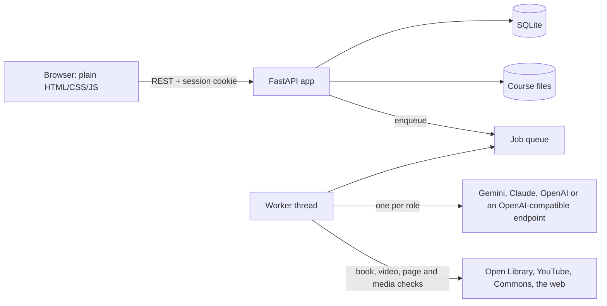

### Components

| Component | Description |
|---|---|
| Frontend (`app/static/`) | Plain ES modules, no build step; marked, DOMPurify, KaTeX, Mermaid, the fonts and Lucide icons are vendored at image build time and hash-checked |
| API (`app/main.py`) | FastAPI routes under `/api`: courses, sessions, items, chat, media, settings, usage, users, audit |
| Course pipeline (`app/pipeline.py`, `prompts.py`, `tiers.py`) | Questions, plan, sessions, checks and the reading list, each a JSON-Schema prompt |
| Learning (`app/learning.py`) | Attempts, marking, warm-ups and spaced review, progress, the tutor |
| Jobs and providers (`app/jobs.py`, `providers.py`, `gemini.py`, `budget.py`, `pricing.py`) | The queue and its worker thread, one interface over Gemini, OpenAI, Anthropic (official SDK) and OpenAI-compatible endpoints, cost logging and the budget |
| Library and people (`app/library.py`, `achievements.py`, `activity.py`, `dashboard.py`) | Tags and each person's shelves, achievements, the opt-in feed and the admin dashboard |
| Packages (`app/package.py`) | `.knwlge` export and the untrusted import |
| Media and checks (`app/media.py`, `verify.py`) | Lesson media and link checking, run in the worker's idle time, public addresses only |
| Accounts (`app/auth.py`, `accounts.py`, `audit.py`) | Modes, sign-in, roles, account commands, the audit log |
| SQLite | Courses, sessions, questions, everyone's progress, jobs, calls, the audit log (WAL mode) |
| Course files | Materials, uploads, pictures and recordings, one folder per course |

More in the [technical wiki](docs/wiki/index.md).

## Requirements

- Docker with the compose plugin (nothing else is installed on your machine)
- A Gemini API key from [Google AI Studio](https://aistudio.google.com/apikey); live research and reading lists need a paid-tier key
- A free port (default 9180) and a modern browser

## Quick Start

```bash
# 1. Get the code
git clone https://github.com/pmsosa/knwlge.git && cd knwlge

# 2. Settings: mode, listen address and port, allowed host names
cp .env.example .env

# 3. Build and start
docker compose up -d --build        # http://<this machine>:9180

# 4. Team mode only: create the first admin (prints a one-time password)
docker compose exec app python -m app.accounts add-admin <username> "<display name>"
```

Open the address, go to **Settings**, paste a Gemini key (or add another provider: OpenAI, Anthropic, or a local
model through any OpenAI-compatible endpoint, and pick it for every role) and test it, then follow the
[user guide](wiki/README.md) from [How to use Knwlge](wiki/how-to-use.md). Knwlge assumes nothing about the network
around it: put it behind HTTPS before using it over a network you don't control.

## Development

```bash
# run the tests in a container (Gemini and the web are faked); the code is baked into the image, hence --build
docker compose run --build --rm app pytest -q

# rebuild and restart after a change (Python or front end)
docker compose up -d --build

# a demo with made-up courses and people, in an empty scratch folder, with the worker off
docker run --rm -e KNWLGE_DATA=/demo -v /path/to/scratch:/demo knwlge python -m app.demo --team
docker run --rm -e KNWLGE_DATA=/demo -e KNWLGE_MODE=team -e KNWLGE_NO_WORKER=1 -v /path/to/scratch:/demo -p 9188:9180 knwlge

# browser smoke test, and the user guide's screenshots, against a throw-away demo (Playwright in a container)
sh tools/e2e.sh
sh tools/e2e.sh shots
# on a box with its own shared Playwright image and runner, e.g.:
E2E_IMAGE=lab-browser E2E_RUN=browser-run sh tools/e2e.sh
```

Database upgrades run at start, after a copy of the database is saved in `data/backups/`. What's next is in
[docs/ROADMAP.md](docs/ROADMAP.md); design decisions in [docs/PLAN.md](docs/PLAN.md) and, for team mode,
[docs/TEAM-PLAN.md](docs/TEAM-PLAN.md).

## Configuration

Settings for the container live in `.env` (`.env.example` explains each one). The AI providers and their keys, which
provider and model each role uses, and the monthly budget are set on the **Settings** page and kept in the database
(keys never reach a browser). Everything else is under `./data`: the
SQLite database, course files and pre-upgrade copies. Back that folder up together with `.env`.

| Variable | Description | Default |
|---|---|---|
| `KNWLGE_MODE` | `personal` (just you; open unless you set a password) or `team` (accounts and roles) | `personal` |
| `KNWLGE_BIND` | Address to listen on: `0.0.0.0` for every interface, `127.0.0.1` behind a reverse proxy | `0.0.0.0` |
| `KNWLGE_PORT` | Port to listen on | `9180` |
| `KNWLGE_ALLOWED_HOSTS` | Host names to answer to besides IP addresses, `localhost` and single-word names; comma-separated, wildcards allowed | empty |
| `TZ` | Time zone for "this month" in the budget | `America/Los_Angeles` |

## Project Structure

```text
knwlge/
├── app/
│   ├── main.py         # FastAPI routes, auth dependencies, security headers, startup
│   ├── db.py           # schema, upgrades, transactions
│   ├── pipeline.py     # making a course; prompts.py has every prompt and schema, tiers.py the depths
│   ├── learning.py     # attempts, marking, warm-ups, progress, the tutor, materials
│   ├── editing.py      # hand edits, section rewrites, Markdown export; package.py the .knwlge export and import
│   ├── jobs.py         # job queue and worker; providers.py (Gemini, OpenAI, Anthropic, compatible), gemini.py, budget.py, pricing.py
│   ├── library.py      # tags and each person's shelves; achievements.py, activity.py (feed), dashboard.py
│   ├── media.py        # lesson media; verify.py checks reading suggestions
│   ├── auth.py         # modes, accounts, roles; accounts.py (CLI), audit.py
│   ├── demo.py         # made-up demo data
│   └── static/         # the web app: index.html, app.css, js/ (views/ per page), icons/
├── tests/              # pytest suite with a fake Gemini (runs in the container); e2e/ has the browser smoke test
├── tools/              # vendor.py (browser libraries, hash-checked at build time), e2e.sh, screenshots.py
├── wiki/               # user guide with screenshots
├── docs/               # technical wiki, roadmap, plans, brand
├── compose.yaml        # the app container
├── .env.example        # settings to copy into .env
└── data/               # database, course files, pre-upgrade copies (created at first run)
```

## License

[BSD 3-Clause](LICENSE). Copyright (c) 2026, Pedro M. Sosa.

The course pipeline and classroom layout were inspired by [SelfSemester](https://github.com/munitkala/selfsemester)
(MIT licence). Knwlge is a separate rewrite in Python; no code was copied. Bundled third-party pieces keep
their own licences: the fonts (SIL Open Font License), Lucide icons (ISC), marked, DOMPurify, KaTeX and Mermaid
(fetched at build time); pictures and recordings in lessons carry their own Wikimedia Commons credits.
