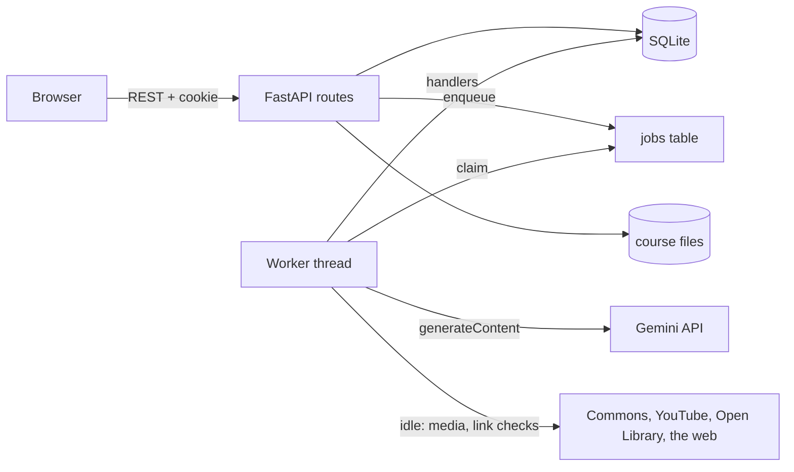

# Architecture

See [index](index.md).

- **Runtime:** one container from the [Dockerfile](../../Dockerfile) (Python, FastAPI, uvicorn), started by
  [compose.yaml](../../compose.yaml). Data in `./data` mounted at `/data`. No database server: SQLite in WAL mode.
- **Background work:** one worker thread in the same process ([app/jobs.py](../../app/jobs.py)). It runs Gemini jobs
  from the `jobs` table by priority, and when idle, non-Gemini tasks: fetching media ([media](media.md)) and checking
  reading suggestions ([reading](reading.md)). `KNWLGE_NO_WORKER=1` turns it off (tests, the screenshot demo).
- **Frontend:** plain HTML, CSS and ES modules in `app/static/`, served by the same app, no build step
  ([frontend](frontend.md)). Third-party libraries are downloaded at image build time and hash-checked.
- **Dependencies:** only in the image (`requirements.txt`, `requirements-dev.txt` when built with `DEV=1`).

## Modules

| Module | Does |
|---|---|
| [main.py](../../app/main.py) | Routes, the auth dependencies, security headers, host check, startup |
| [db.py](../../app/db.py) | Schema, upgrades, connections and transactions, settings |
| [auth.py](../../app/auth.py), [accounts.py](../../app/accounts.py), [audit.py](../../app/audit.py) | Modes, accounts, sessions, roles; account commands; the audit log |
| [jobs.py](../../app/jobs.py), [gemini.py](../../app/gemini.py), [budget.py](../../app/budget.py), [pricing.py](../../app/pricing.py) | The queue and worker; the REST client; spend and the cap; prices and default models |
| [pipeline.py](../../app/pipeline.py), [prompts.py](../../app/prompts.py), [tiers.py](../../app/tiers.py) | Making a course; every prompt and JSON Schema; depths |
| [editing.py](../../app/editing.py) | Hand edits, section rewrites by Gemini, renaming, Markdown export |
| [learning.py](../../app/learning.py) | Attempts, marking, warm-ups, progress, the tutor, materials |
| [media.py](../../app/media.py), [verify.py](../../app/verify.py) | Lesson media; checking links and books |
| [demo.py](../../app/demo.py) | Made-up demo data for screenshots |

## Request flow

Browser (hash router) → `fetch /api/...` with the `knwlge_session` cookie and, on writes, the `x-knwlge` header →
middleware (host check, security headers, header check on writes) → route → `me` dependency (resolves the user, or
the owner in open personal mode; sets `auth.actor` for attribution) → `viewable` / `editable` / role checks → a
transaction (`db.tx()`) → JSON. Anything slow (Gemini) is enqueued as a job and the page polls.

