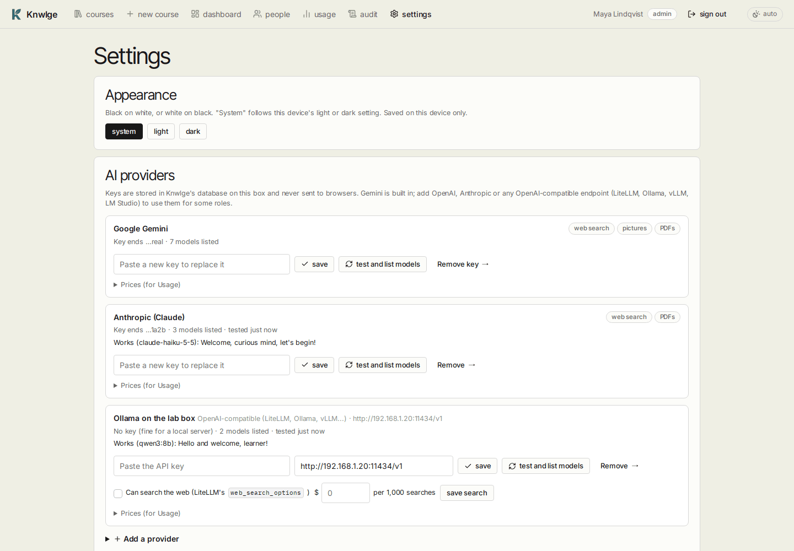
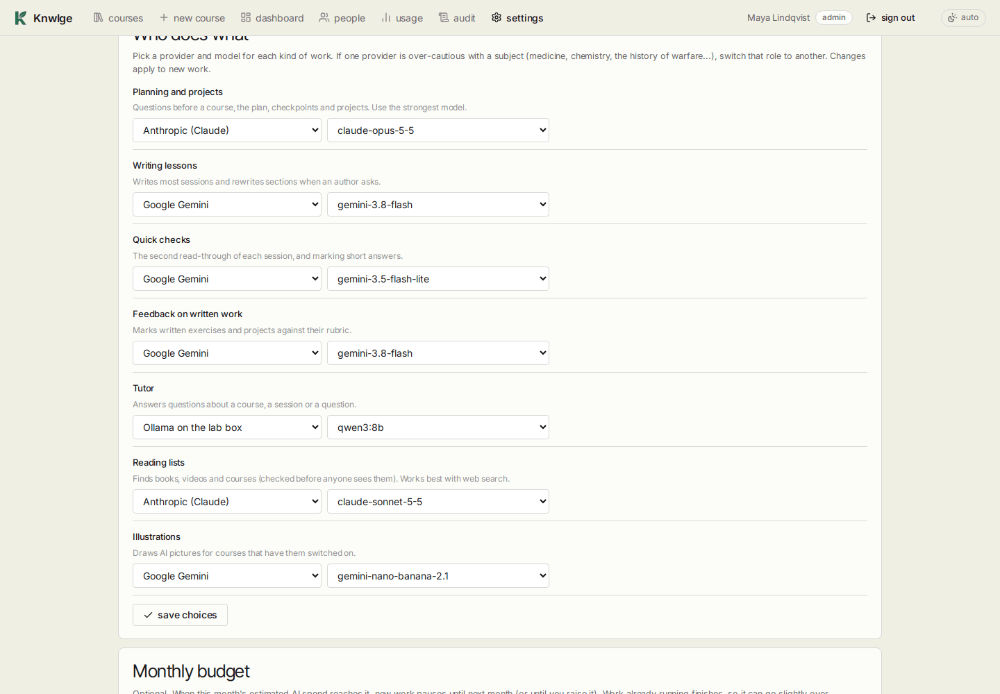
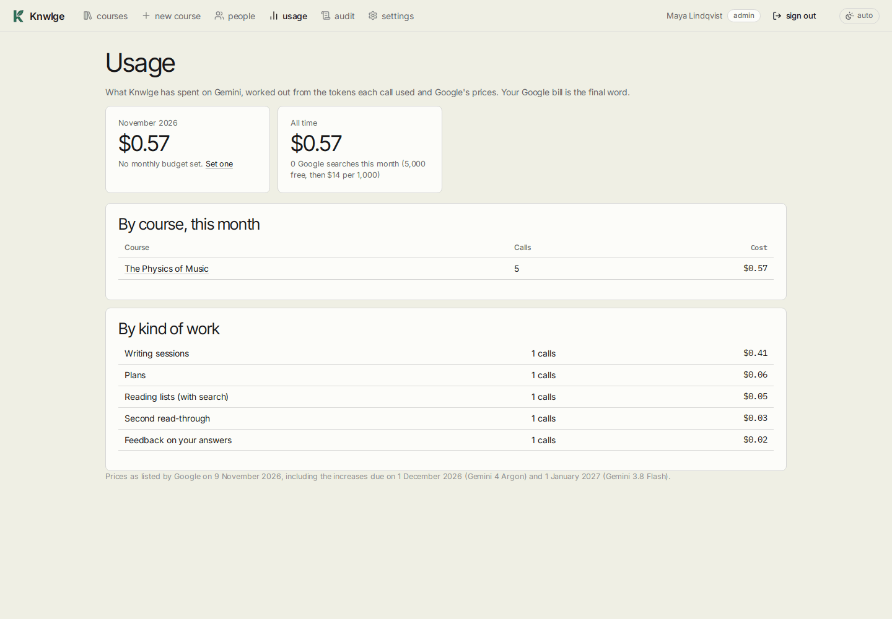
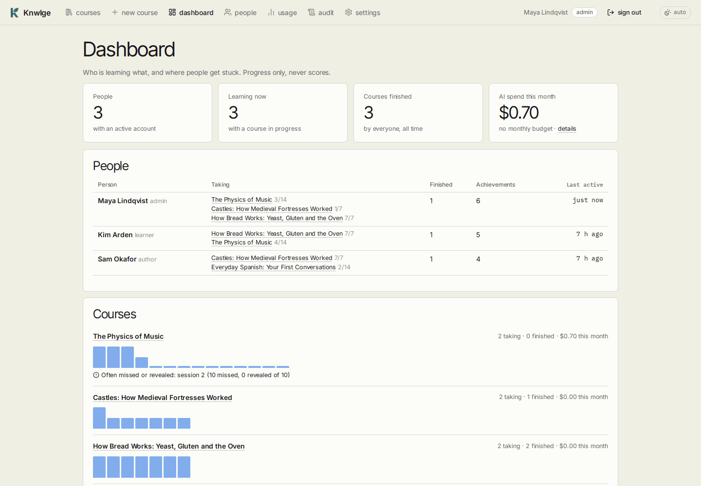
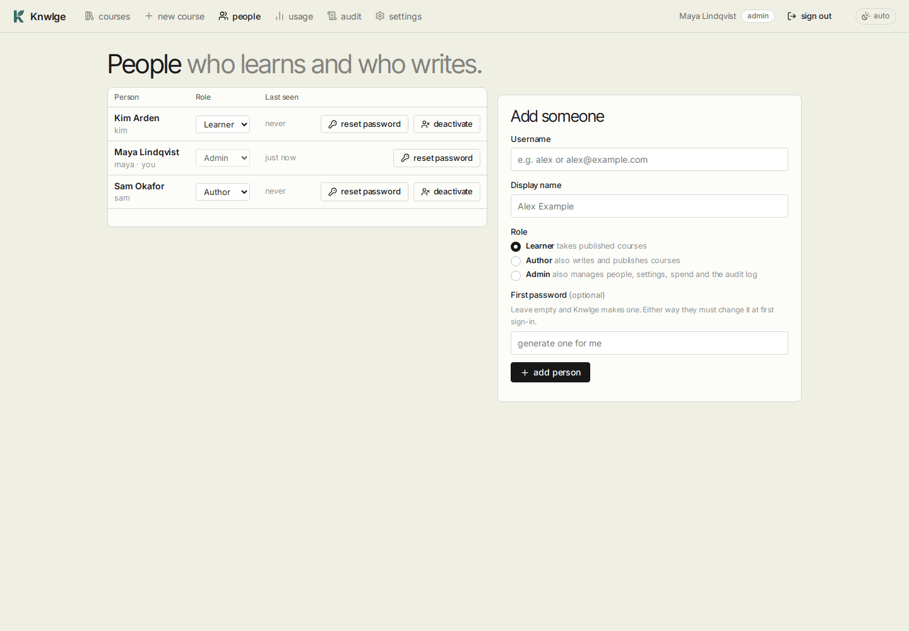
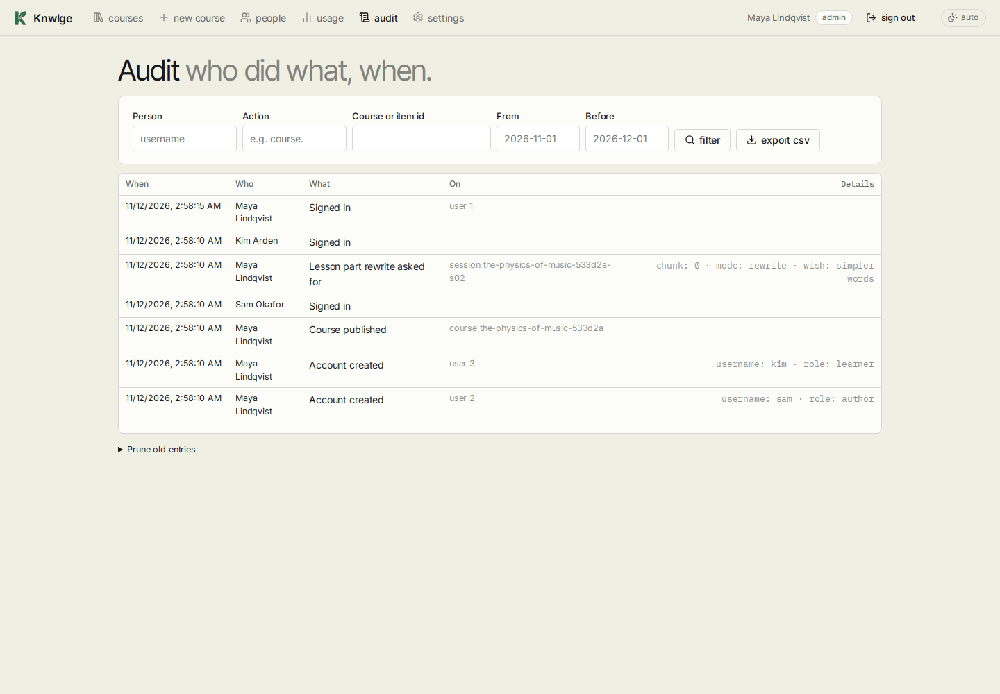

# Administration

[Guide home](README.md) · Previous: [Editing a course](editing-courses.md)

For admins. In personal mode you're the admin; **dashboard**, **people** and **audit** only exist in team mode.

## Settings



| Section | What it does |
|---|---|
| Appearance | Auto, light or dark, for this browser |
| AI providers | Gemini is built in; add OpenAI, Anthropic or an OpenAI-compatible endpoint. Each has **save**, **test and list models**, **remove**, and **Prices** (see below). Keys never leave the server and aren't shown again |
| Who does what | A provider and model for each kind of work (see below) |
| Monthly budget | A cap in dollars, or **no limit** (the default). When the month's spend reaches it, new work pauses until next month or until you raise it |
| Password (personal mode) | Off by default: the app just opens. Set one and Knwlge asks for it; **turn off password** opens it again |
| Paused work | Work pauses when a provider rate-limits, refuses its key, or the budget is reached. **resume paused work now** tries again (saving settings does too) |

## AI providers



**Add a provider** takes:

- **OpenAI**: an API key. Writes through Chat Completions and searches the web through its Responses API for live
  research and reading lists ($10 per 1,000 searches, counted in Usage); draws pictures with an image model such as
  `gpt-image-1`.
- **Anthropic (Claude)**: an API key. Has web search for live research and reading lists; can't draw pictures. On the
  newest Claude models a declined request is retried on another Claude model by Anthropic itself.
- **OpenAI-compatible**: the address of anything that speaks the OpenAI API, such as LiteLLM, Ollama
  (`http://<machine>:11434/v1`), vLLM or LM Studio, and a key if it wants one. Small local models can struggle to
  write a whole lesson; try one role (the tutor, say) before giving them more. Tick **Can search the web** only if the
  endpoint really searches: a LiteLLM proxy (v1.71 or newer) whose models support `web_search_options` (Gemini, Claude,
  xAI, Perplexity, OpenAI's search models). If a model behind it won't, that step is written without search and says
  so. Type what its searches cost per 1,000 next to it, or they count as free.

Adding one tests it straight away: it lists the models the key can use and asks one of them for a tiny answer. The
result shows on its card. **test and list models** runs it again.

**Who does what** picks a provider and model for each kind of work:

| Role | What it does |
|---|---|
| Planning and projects | Questions before a course, the plan, checkpoints and projects. Use the strongest model |
| Writing lessons | Most sessions, and section rewrites |
| Quick checks | The second read-through of each session, and marking short answers |
| Feedback on written work | Marking written exercises and projects against their rubric |
| Tutor | Answers about a course, a session or a question |
| Reading lists | Books, videos and courses (works best with web search) |
| Illustrations | AI pictures (Gemini or OpenAI only) |

A role nobody has changed uses Gemini with the model it always had. If one provider is over-cautious with a subject
(medicine, chemistry, the history of warfare...), switch that role to another. Removing a provider sends its roles
back to Gemini. Changes apply to new work, not to what's already written.

**Prices**: Knwlge knows Gemini's and Claude's prices. For other models, open **Prices** on the provider's card and
type dollars per million input and output tokens (0 for a free local model); until then their calls count as
"unknown price" in Usage.

## Usage and the budget



Every AI call is logged with the provider, the tokens it used and its cost, from built-in price tables (Gemini's,
including Google's announced December 2026 and January 2027 increases, and Claude's) or the prices you typed in.
**usage** shows this month and all time, by course, by person (team mode) and by kind of work, and how many Google
searches were used (5,000 a month are free); the dashboard adds spend by provider. Your providers' bills are the final
word. Learners never see costs.

Rough costs: planning is a few cents; a Boot Camp is about 30-35 calls to build, mostly writing sessions; feedback,
tutor answers and section rewrites are a cent or two each; an AI illustration is about 3¢.

## The dashboard



**dashboard** (team mode) shows, for admins only:

- **People**: what each person is taking and how far they are (sessions done, never scores), what they've finished,
  their achievements and when they were last active.
- **Courses**: how many are taking each one and how many finished it, a bar per session for how many people finished
  it (where the bars drop is where people stop), and the sessions whose questions are often missed or revealed.
- **Spend** this month by provider and by person.
- **Activity feed**: the switch for everyone, how many people share, and the latest entries.

### The activity feed

The feed shows when someone finishes a session or a course, or earns an achievement: on the home page under
**Recently**, and on the dashboard. It's opt-in twice over: an admin can turn it off for everyone, and each person
chooses in their account (**Share my activity**, off by default) whether they appear. Nothing is recorded for someone
who isn't sharing, so turning it on later never shows the past; turning it off removes their entries. Drafts never
appear, and entries older than 90 days are cleared.

## People (team mode)



| Role | Can |
|---|---|
| Learner | Take published courses, ask the tutor |
| Author | Also make courses, edit and publish their own |
| Admin | Also manage people, settings, spend and the audit log, and edit any course |

- **Add someone**: username, display name, role, and a first password (leave it empty and Knwlge makes one). It's
  shown once; give it to them privately. They must choose their own at first sign-in.
- **Role**: change it in the list. You can't change your own role, and the last active admin can't be demoted.
- **reset password**: makes a new one-time password and signs them out everywhere.
- **deactivate**: signs them out and stops them signing in. Their progress is kept; **reactivate** brings them back.

## The audit log



Who did what, and when: sign-ins (and failed ones), accounts made and changed, courses made, published, renamed,
exported and deleted, sections and questions edited (with before and after), section rewrites asked for and done,
key, model and budget changes. Never passwords or the key. Filter by person, action, course or item and dates;
**export CSV**; **prune** removes entries older than a date.

## From the command line

Run these from the folder Knwlge is installed in (or point `-f` at its `compose.yaml`):

```sh
docker compose exec app python -m app.accounts add-admin <username> "<display name>"   # first admin; prints a one-time password
docker compose exec app python -m app.accounts reset-password <username>              # if an admin is locked out
docker compose exec app python -m app.accounts list
```

`add-admin` on a fresh team install (or one switched over from personal mode) takes over the personal-mode owner,
so every course and setting made so far becomes the new admin's.

## Switching modes

Set `KNWLGE_MODE=team` (or `personal`) in `.env` and run `docker compose up -d`. Going to team mode: create the first
admin as above. Going back: the accounts stay in the database, and the app opens without signing in again.

## Backups

Everything lives in `data/`: the SQLite database, course files (materials, pictures, recordings) and uploads. Back
up that folder together with `.env`. Before every database upgrade Knwlge saves a copy in `data/backups/` by itself.
**Download as Markdown (zip)** on a course's **Course** tab exports one course for reading elsewhere.
