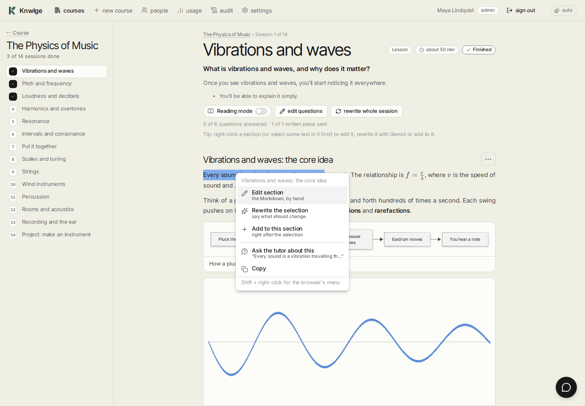
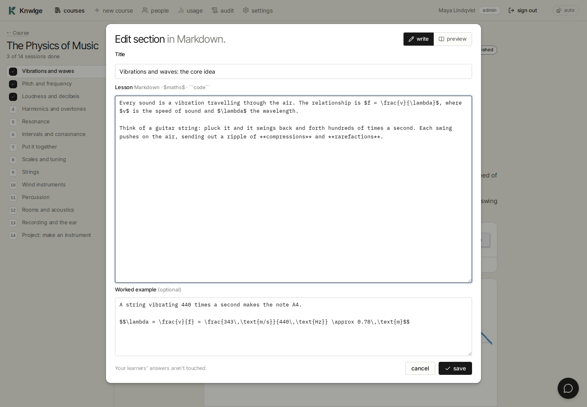
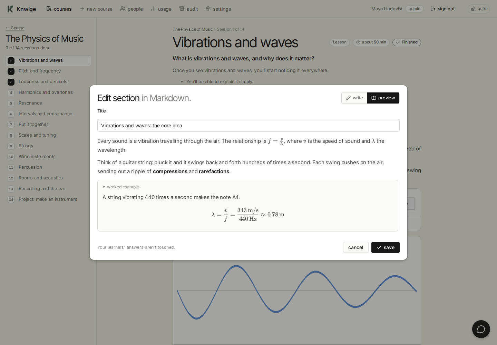
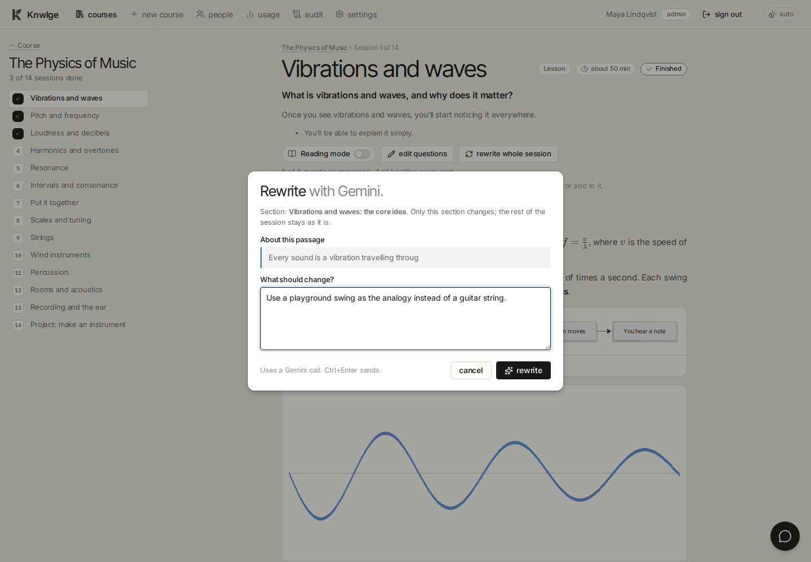
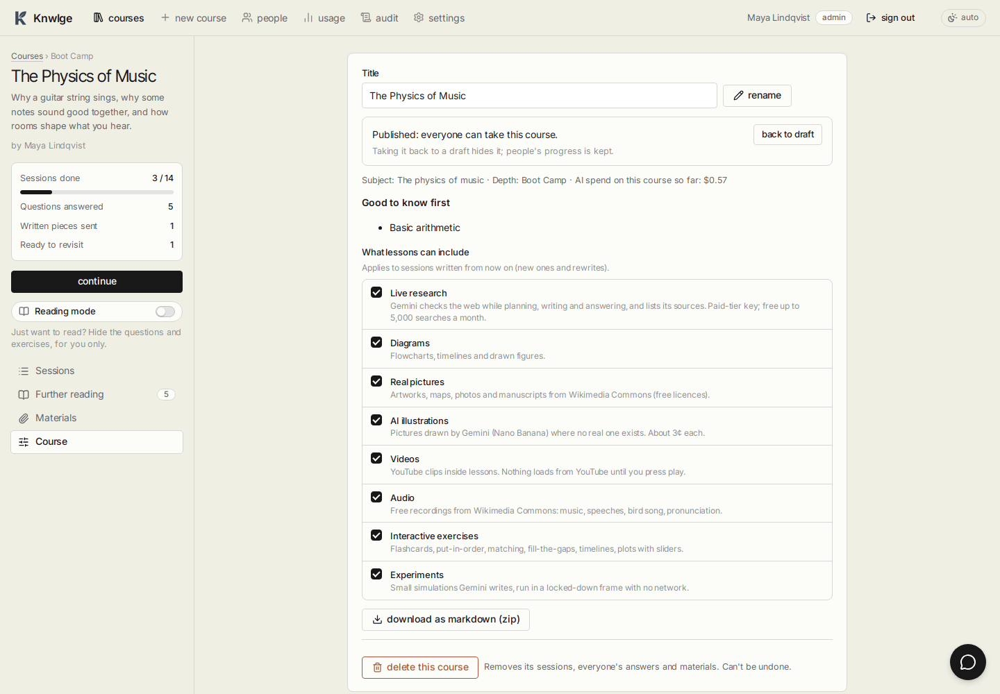

# Editing a course

[Guide home](README.md) · Previous: [The tutor](the-tutor.md) · Next: [Administration](administration.md)

Gemini's first draft is a starting point. Authors can change any course they made, and admins any course at all (in
personal mode, you can change everything). Learners don't see any of this.

## The section menu

Right-click anywhere in a lesson section, or select some text in it first and right-click the selection:

| Item | What it does |
|---|---|
| **Edit section** | Opens the section's Markdown in a dialog ([below](#edit-by-hand)) |
| **Rewrite with Gemini** (or **Rewrite the selection**) | Gemini rewrites just this section the way you ask |
| **Add to this section** | Gemini works something new into the section, after your selection if you made one |
| **Ask the tutor about this** | Opens the [tutor](the-tutor.md) with the passage quoted |
| **Copy** | Copies the selection (shown when you selected something) |

- **Shift + right-click** opens your browser's own menu instead.
- On a touch screen, use the **⋯** button that appears on each section's heading (on a desk it shows when you hover).
- Learners get the menu too, with just **Ask the tutor about this** and **Copy**.

## Edit by hand

The section's **title**, its **lesson** text and its **worked example**, as Markdown. Write `**bold**`, `*italics*`,
lists, `$inline maths$`, `$$display maths$$` and fenced code blocks. If you selected text before opening it, the cursor
lands on that passage. **preview** shows it rendered; **save** puts it live straight away. Learners' answers aren't
touched.

## Rewrite or add with Gemini

Say what should change ("simpler words", "use a sports analogy", "shorter", "fix the second paragraph") or what you'd
like to see added ("a table comparing the three", "a common mistake to watch for"). **Ctrl+Enter** sends.

- Only that section changes; the rest of the session, its questions and its pictures stay as they are.
- The section fades and says **Gemini is rewriting this section**. A minute later the new version swaps in by itself,
  without moving your place on the page. You can keep reading or edit other sections meanwhile.
- If it fails, the reason appears in the box at the top of the session.
- Each rewrite is one Gemini call, counted in the usage. With **Live research** on, Gemini checks facts on the web.
- What was asked, and the section before and after, are kept in the [audit log](administration.md#the-audit-log)
  (team mode).

## Questions, pictures and whole sessions

At the top of a session, for authors and admins:

- **Edit questions** shows **Edit** and **Delete** on every question, and edit controls on pictures. A question's
  edit form has the question, the options (for multiple choice), the answer and the explanation. **Done editing
  questions** switches it off.
- **Rewrite whole session** writes the session again from scratch, with anything you'd like different. Everyone's
  answers in that session are cleared, because the questions change.

## Materials

The **Materials** tab holds your own files for the course (PDFs, pictures, notes; up to 12 of 15 MB each), or a note
typed straight in. Gemini reads them when planning and writing sessions and when answering the tutor.

## Course settings

The **Course** tab:

- **Rename** the course.
- **publish** / **back to draft** (team mode): drafts are seen only by their author and admins; taking a course back
  to draft hides it, and people's progress is kept.
- **What lessons can include**: switch the extras on or off. This applies to sessions written from then on (new ones
  and rewrites).
- **Download as Markdown (zip)**: every session as a Markdown file, with your own answers, feedback and notes.
- **Delete this course**: removes it and everything in it, for everyone. It asks first.
