# Editing a course

[Guide home](README.md) · Previous: [The tutor](the-tutor.md) · Next: [Administration](administration.md)

The AI's first draft is a starting point. Authors and admins can change any course (in personal mode, you can change
everything); learners can change only courses of their own, when an admin lets them make some
([Administration](administration.md#changes-and-courses)). Every change is kept as a version you can go back to, and
anything the AI writes comes back as a **draft** you look at before learners see it.

## The section menu

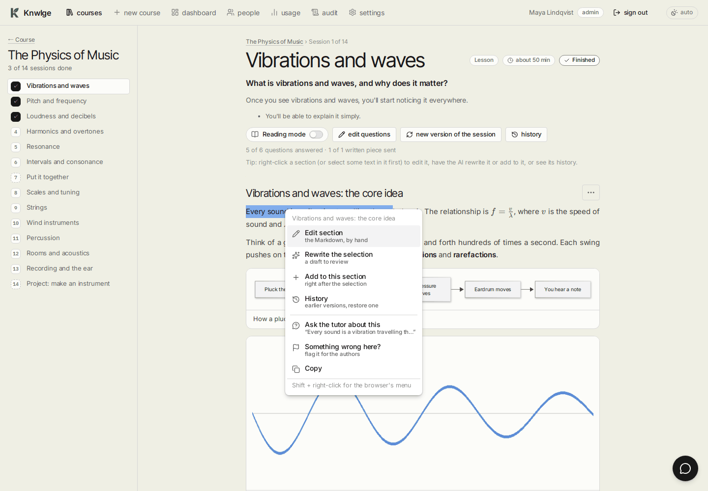

Right-click anywhere in a lesson section, or select some text in it first and right-click the selection:

| Item | What it does |
|---|---|
| **Edit section** | Opens the section's Markdown in a dialog ([below](#edit-by-hand)) |
| **Rewrite with the AI** (or **Rewrite the selection**) | The AI drafts a new version of just this section, the way you ask |
| **Add to this section** | The AI works something new into the section, after your selection if you made one |
| **History** | Every version of this section, and restoring any of them ([below](#history-and-going-back)) |
| **Ask the tutor about this** | Opens the [tutor](the-tutor.md) with the passage quoted |
| **Something wrong here?** | Flags the section for the authors ([Studying](studying.md#flag-a-problem)) |
| **Copy** | Copies the selection (shown when you selected something) |

- **Shift + right-click** opens your browser's own menu instead.
- On a touch screen, use the **⋯** button that appears on each section's heading (on a desk it shows when you hover).
- Learners get the menu too, with just **Ask the tutor**, **Something wrong here?** and **Copy**.

## Edit by hand

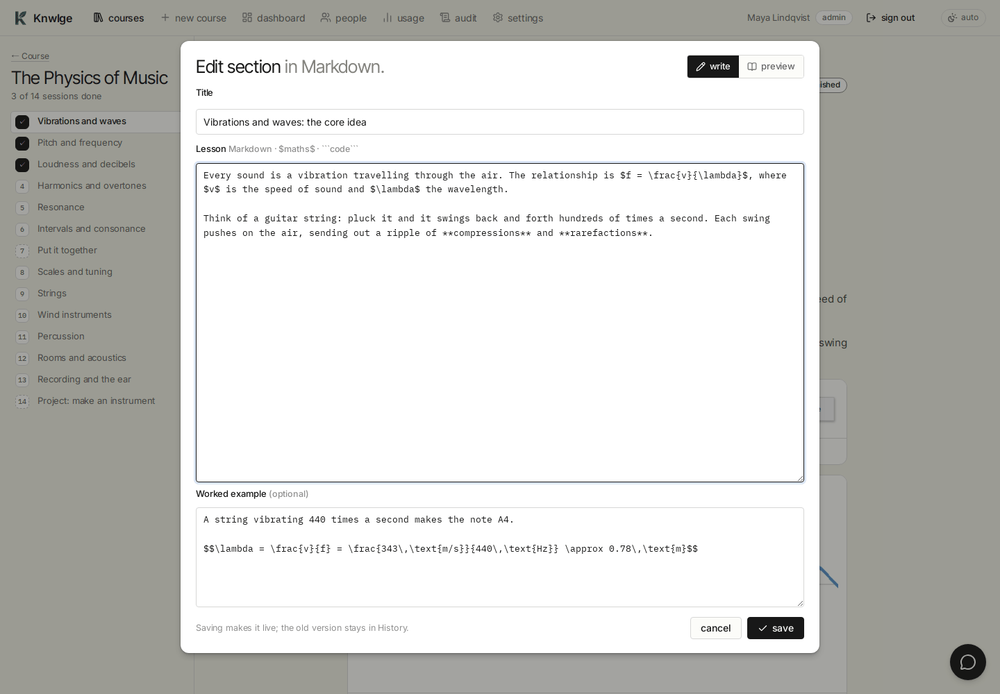

The section's **title**, its **lesson** text and its **worked example**, as Markdown. Write `**bold**`, `*italics*`,
lists, `$inline maths$`, `$$display maths$$` and fenced code blocks. If you selected text before opening it, the cursor
lands on that passage. **preview** shows it rendered; **save** puts it live straight away (the old version stays in
History). Learners' answers aren't touched. With [review](#review-before-it-goes-live) switched on and a course that
isn't yours, **save** sends it to the course's owner instead.

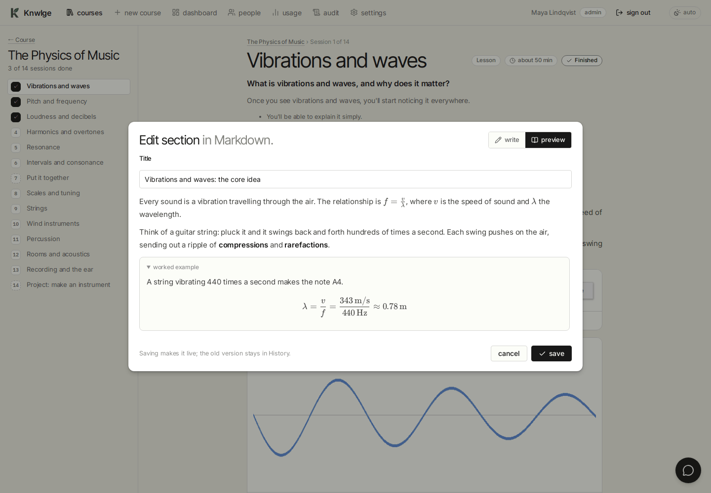

## Rewrite or add with the AI

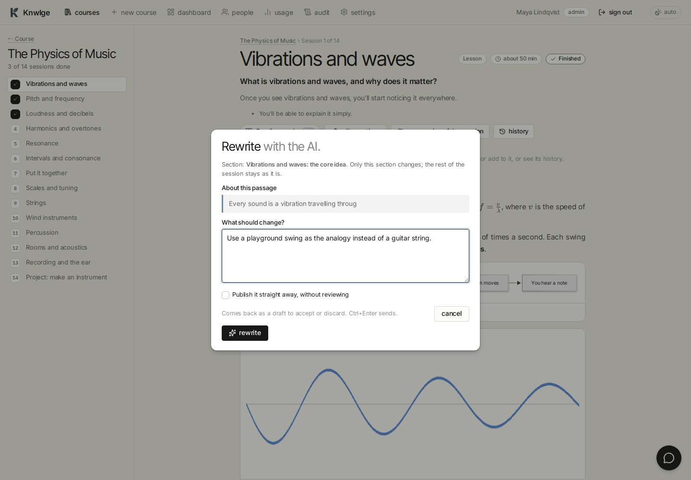

Say what should change ("simpler words", "use a sports analogy", "shorter", "fix the second paragraph") or what you'd
like to see added ("a table comparing the three", "a common mistake to watch for"). **Ctrl+Enter** sends.

- Only that section changes; the rest of the session, its questions and its pictures stay as they are.
- The section fades and says the AI is drafting it. A minute later a bar on the section says **A new version from the
  AI is ready to review**: press **review** ([below](#drafts-and-review)). Learners keep seeing the old version until you
  accept it.
- **Publish it straight away, without reviewing** (a tick box, for people who can publish) skips the draft: it goes
  live as soon as it's written. It's still kept in History, so you can go back.
- If it fails, the bar says so; discard it and ask again.
- Each rewrite is one AI call, counted in the usage. With **Live research** on, the AI checks facts on the web.

## Drafts and review

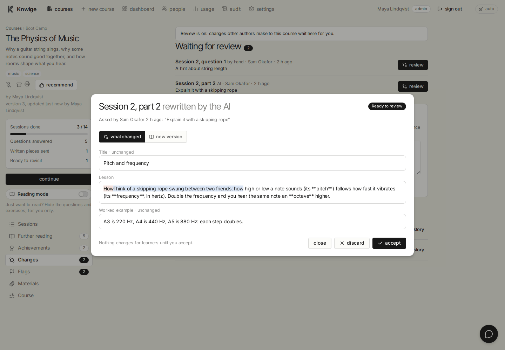

**review** opens the draft: **what changed** shows the old and new text word by word (struck out and highlighted),
**new version** shows it as learners will see it. **accept** puts it live; **discard** throws it away.

- Drafts wait on the section, question or session they're for, and all together on the course's **Changes** tab.
- If the section changed again after the draft was made, the draft says so; **accept anyway** replaces those newer
  changes (they stay in History).
- Whoever asked for a draft can discard it; accepting it needs the right to publish (below).

### Review before it goes live

In team mode an admin can switch on **Review changes before they go live** ([Administration](administration.md#changes-and-courses)).
Then, when an author changes a course that isn't theirs, the change waits on the Changes tab for the course's owner or
an admin, whether it's a hand edit, an AI draft or going back to an earlier version. Owners and admins still publish
straight away. With review off (the default), anyone who can edit publishes their own changes.

## History and going back

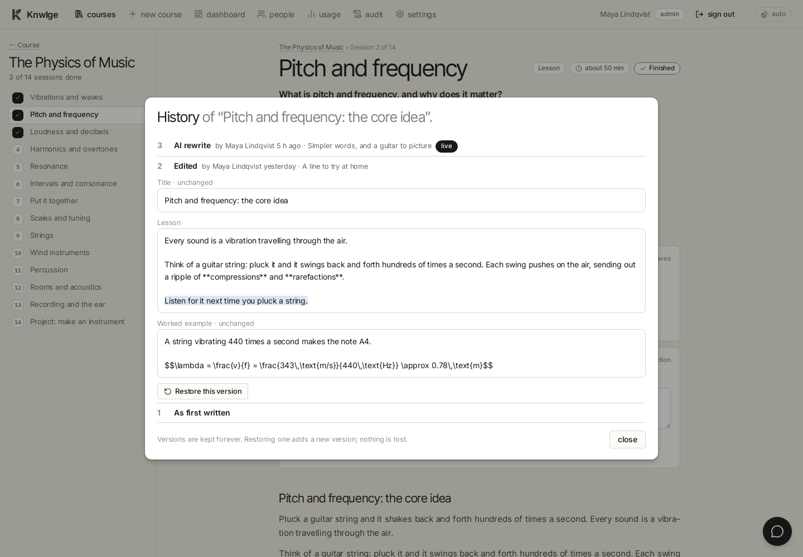

Every change to a section, a question, a session or the plan is kept as a version, forever: who made it, when, and
why (what was asked of the AI, or the note given with an edit). **History** (in the section menu, on a question
while editing questions, at the top of a session, and **plan history** on the Changes tab) lists them newest first;
open one to see what it changed, and **Restore this version** to go back. Restoring adds a new version, so nothing is
lost. The Changes tab also lists the course's recent changes.

## Questions, pictures and whole sessions

At the top of a session, for authors and admins:

- **Edit questions** shows, on every question, **Edit**, **Rewrite with the AI** (a draft, the same kind of question),
  **History** and **Take out**, and edit controls on pictures. A question's edit form has the question, the options
  (for multiple choice), the answer and the explanation. **Done editing questions** switches it off.
- When a question or its answer key changes, people who already answered keep their result, with a note that the
  question changed since; nothing is marked again behind their back. Taking a question out keeps their answers too.
- **New version of the session** has the AI write the whole session again, with anything you'd like different, as a
  draft. Like a new session, the draft is read through by a second model first; major problems get one more try,
  and anything still wrong is listed at the top of the review. The live session stays as it is until you accept; then its old questions and pictures are archived with
  everyone's answers, and **History** at the top of the session can bring that version back.

## Changing the plan

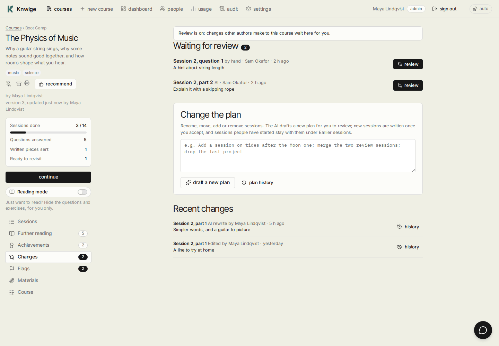

Once every session is written, **Change the plan** on the course's **Changes** tab lets you rename, move, add or remove
sessions in plain words ("add a session on tides after the Moon one", "drop the last project"). The AI drafts a new
plan; the review shows each session as new, moved, renamed, removed or to be rewritten. When you accept:

- new sessions are written in the background;
- a session whose topics really changed gets a draft rewrite of its own to review;
- a removed session that people have started stays with them under **Earlier sessions**, with their answers and notes;
  nobody else sees it;
- **plan history** can put the old plan back.

## Flags from learners

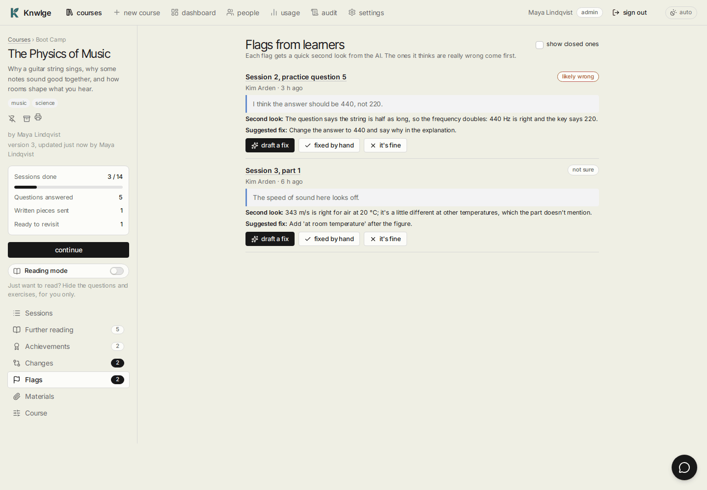

Learners can flag a section, a question or its answer, feedback on their written work, or a reading suggestion
([Studying](studying.md#flag-a-problem)). Each flag gets a quick second look from the AI straight away, and the
course's **Flags** tab lists them, the ones it thinks are really wrong first, with its reason and a suggested fix:

- **Draft a fix** (sections and questions): the AI drafts a fix from the flag, to review like any draft. Accepting it
  closes the flag as fixed.
- **Mark it again** (feedback): the learner's answer is marked again.
- **Take it off the list** (reading): the suggestion is removed.
- **Fixed by hand**, or **It's fine**: close it, with an optional reply. The learner sees what happened, and your
  reply, on their account page.

## Materials

The **Materials** tab holds your own files for the course (PDFs, pictures, notes; up to 12 of 15 MB each), or a note
typed straight in. Gemini reads them when planning and writing sessions and when answering the tutor.

## Course settings

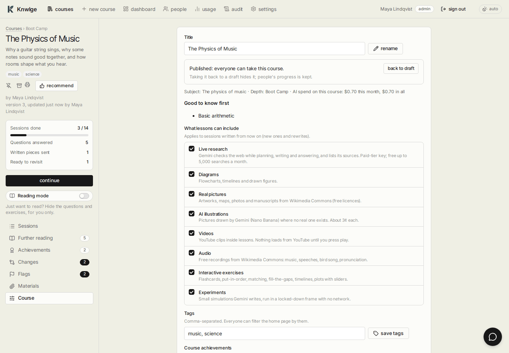

The **Course** tab:

- **Rename** the course.
- **publish** / **back to draft** (team mode, the course's owner or an admin): drafts are seen only by their owner and
  admins. A learner's own course is private, with **suggest for everyone** instead; authors and admins then see it and
  can publish it. Taking a course back
  to draft hides it, and people's progress is kept.
- **What lessons can include**: switch the extras on or off. This applies to sessions written from then on (new ones
  and rewrites).
- **Tags**: comma-separated, shared by everyone and used to filter the home page. The AI suggests two or three with
  the plan; yours replace them.
- **Course achievements**: the two or three themed ones the AI wrote with the plan (see
  [Studying](studying.md#achievements)). Change their title and description, what earns them (finishing a session,
  trying every question in it, or sending its written work) and which session, add or remove some, then **save
  achievements**. People keep what they've already earned.
- **Share or keep a copy**: see below.
- **Delete this course** (its owner or an admin): removes it and everything in it, for everyone. It asks first.
- **What it costs**: the course's owner and admins see its AI spend so far, this month and in all, next to its
  subject and depth.

## Recommending a course (team mode)

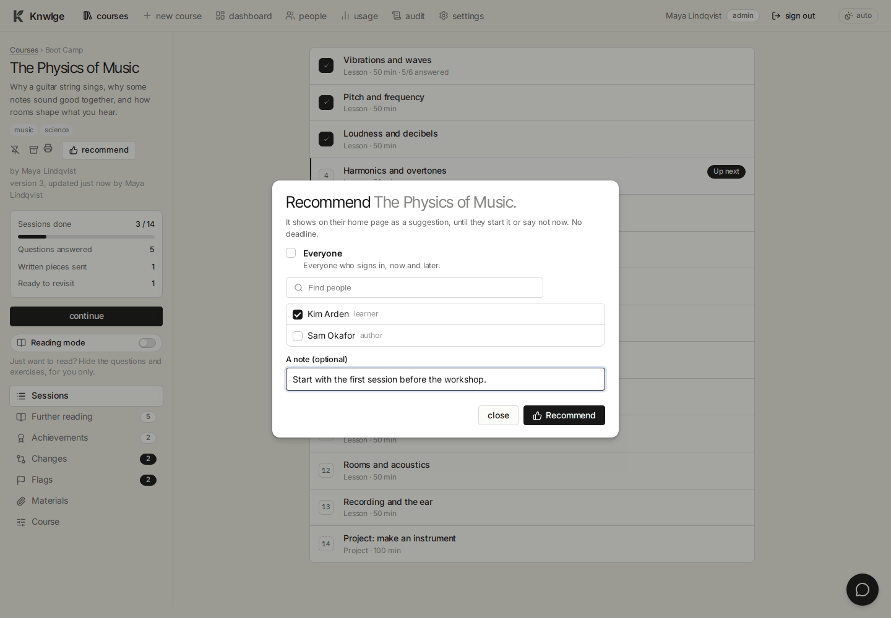

On a published course, authors and admins have **recommend** under the title. Pick **Everyone** (everyone who signs
in, now and later) or tick people, add a note if you like, and press **Recommend**. It shows on their home page under
**Recommended for you** until they start the course or say not now. There are no deadlines and nothing to track:
the dashboard already shows who's taking what. The same dialog lists who it's recommended to; **take back** removes one
(yours, or anyone's if you're an admin). Recommending the same person again replaces the older one and shows it again
even if they'd said not now.

## Printing and sharing

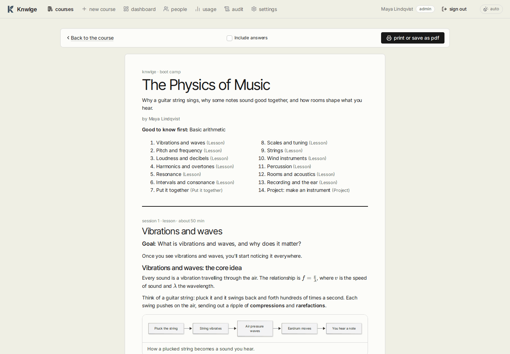

- **Print or save as PDF** (also the printer icon under every course's title, for everyone): the whole course on one
  page, laid out for paper, each session starting on a new page. Press **print or save as PDF** and pick "Save as PDF"
  in the browser's print window. **Include answers** adds the answer key under each question: authors see them all,
  learners only the ones they've tried or revealed. Videos, recordings and interactive parts appear as a note.
- **Download course package**: a `.knwlge` file with the whole course (plan, sessions, questions and answer keys,
  pictures, the reading list, tags and achievements) for another Knwlge, or to keep. Tick **Include my own progress and
  notes** to take your study with you; nobody else's is ever included.
- **Markdown (zip)**: every session as a Markdown file, with your own answers, feedback and notes.

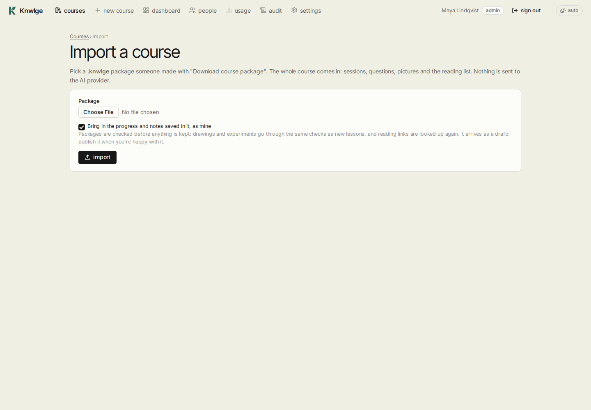

**import** (on the home page, for authors and admins) brings a package in as a new course of your own (a draft in team
mode). Nothing is sent to the AI. Packages are treated as untrusted: drawings and experiments get the same checks as
new lessons, pictures and recordings without a proper file are fetched again, reading links are checked again, and
anything that doesn't fit is left out. A session the package didn't have shows as failed; **Try again** writes it.
