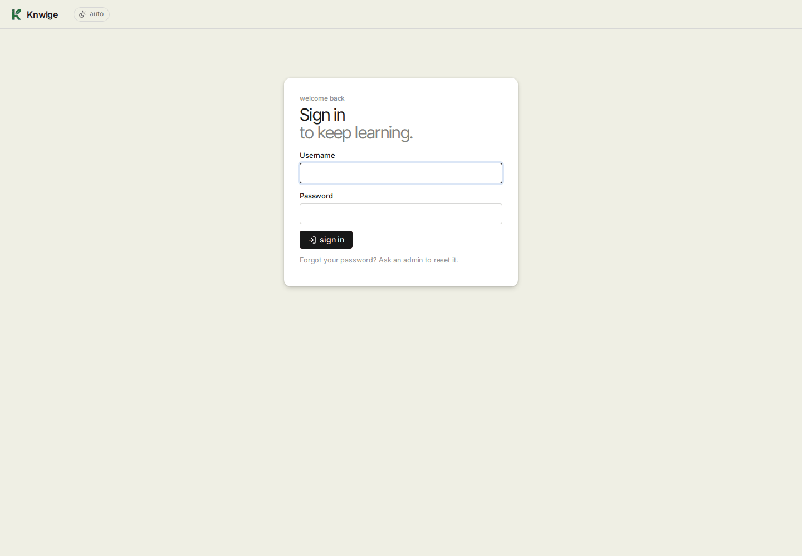
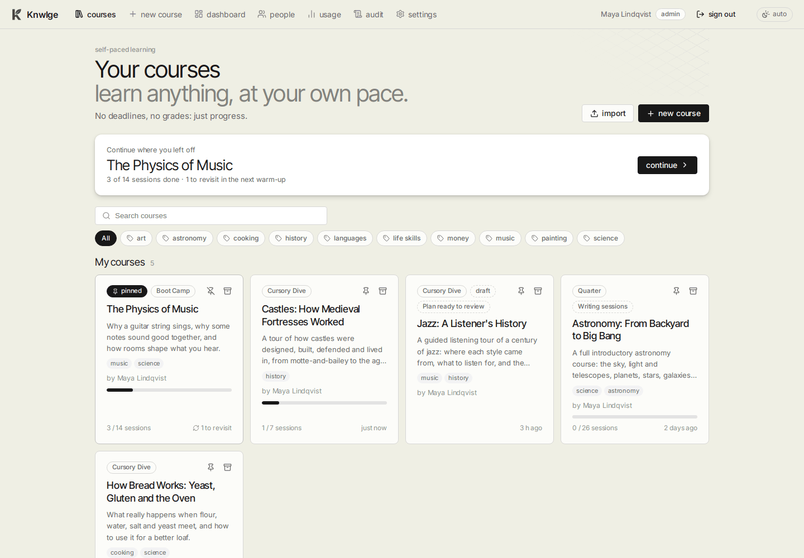
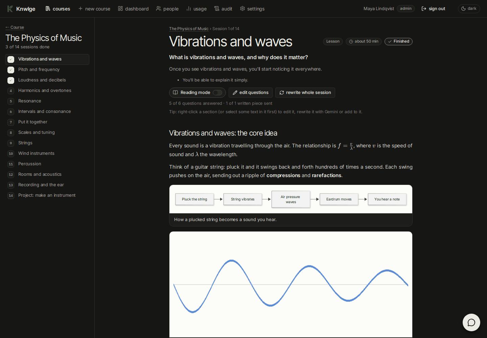
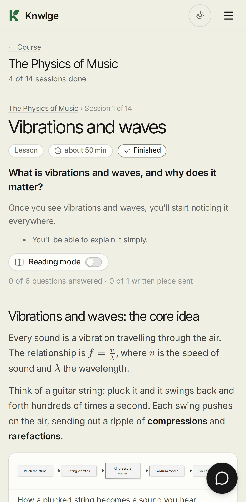
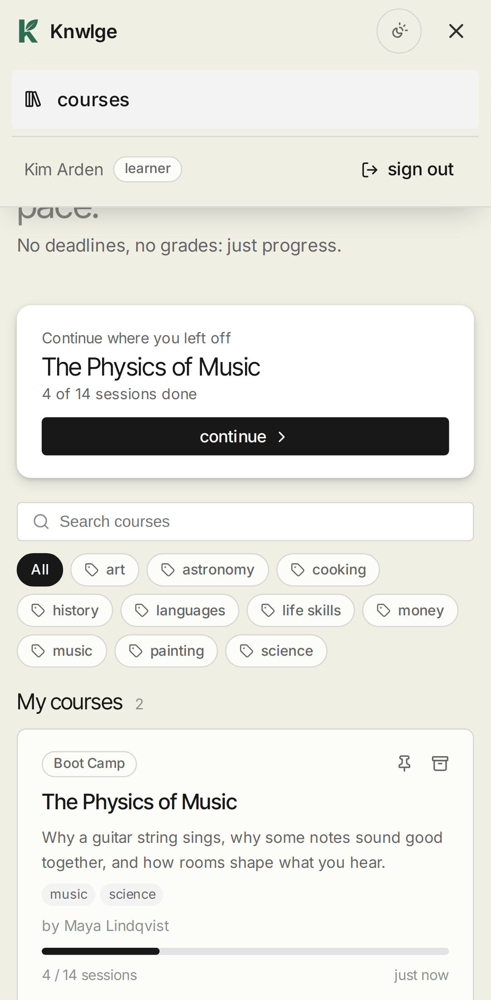

# Getting started

[Guide home](README.md) · Previous: [How to use Knwlge](how-to-use.md) · Next: [Making a course](making-a-course.md)

## Personal or team

Knwlge runs in one of two modes, chosen when it's installed (`KNWLGE_MODE` in `.env`):

| | Personal | Team |
|---|---|---|
| Who | just you, with every permission | accounts made by an admin: learners, authors and admins |
| Signing in | none; it simply opens. You can set a password in **Settings** if you want one | everyone signs in with a username and password |
| Courses | yours | drafts until their author publishes them; everyone's progress is their own |
| Extra pages | | **people** and **audit**, for admins |

## Signing in (team mode)

Open the address you were given and sign in with the username and password an admin gave you. The first time (or
after an admin resets your password) Knwlge asks you to choose your own: at least 10 characters, and not your
username. Too many wrong tries in a row and it makes you wait a little before the next one.

**sign out** is in the top bar, next to your name and role.

### Your name

Click your name in the top bar to change the name others see (on courses you write, in the people list and the audit
log). The username you sign in with stays the same. The same page has **change password**.

## Finding your way around

- **courses** (the home page): a **continue** banner for where you left off, then your courses, then everything else
  (see below).
- **new course**: make one (authors and admins). **import** next to it brings in a course package.
- **dashboard**, **people**, **usage**, **audit**, **settings**: for admins (in personal mode you're the admin, and
  dashboard, people and audit don't appear).

### Your courses and the rest

The home page has two parts, split by a line:

- **My courses**: the ones you're taking. A course moves up here by itself once you start it (finish a session or
  answer a question). Pinned ones come first. A course an author is still making is theirs too.
- **Available**: everything else you can open. **+** on a card adds it to your courses without starting it.

On each of your cards, the pin keeps it at the top, and the box icon **moves it to available** when you're done with
it or putting it aside. Your progress stays; start it again (or press **+**) and it comes back up. Pins and shelves are
yours alone: nobody else's home page changes.

**Search** looks through titles, subjects, summaries and tags. The **tags** under it filter both parts at once; press
**All** to clear. Tags are shared: the AI suggests two or three when it plans a course, and authors change them in
the course's **Course** tab.

What you can't use isn't shown. Inside a course the outline stays on the left and only the content on the right
scrolls, so the page itself never moves.

## Light and dark

The button at the right end of the top bar switches between **auto** (follows your device), light and dark. The
same choice is under **Settings → Appearance**. Diagrams and plots keep a light background in both.

## On a phone

Knwlge works in a phone browser. The top bar keeps just the logo, the theme button and a **menu** button; the
links, your name and **sign out** open from the menu (it does the same in narrow windows on a desk). The outline moves
above the content, paragraphs stop being justified (narrow columns leave gaps), and the tutor's chat fills the screen.
On a touch screen, long-press works as usual (to select text); editors get a **⋯** button on each section's heading
instead of the right-click menu.

 

## Installing it as an app

Over HTTPS (or on `localhost`), browsers offer to install Knwlge: **Install app** in Chrome or Edge's address bar,
**Add to Home Screen** on a phone. It then opens in its own window with the green K as its icon. Knwlge keeps its own
files (the page, styles, scripts, fonts and icons) on the device so it opens quickly; your courses and answers always
come from the server, so you need a connection to study.

## Adding the AI key

Knwlge uses an AI to plan, write, mark and answer: Google's Gemini by default, or OpenAI, Anthropic's Claude or a local
model. An admin (you, in personal mode) opens **Settings** and, under **AI providers**, pastes a Gemini key from
[Google AI Studio](https://aistudio.google.com/apikey) into the Google Gemini box and presses **save** (it's tested
straight away). To use another provider, open **Add a provider** instead and then pick it under **Who does what**.
Keys stay on the server: they're never sent to a browser and never shown again (only the last few characters).
Live research and the reading list need web search: a paid-tier Gemini key or Claude; other providers write without
it and say so.

More: [Administration](administration.md).
