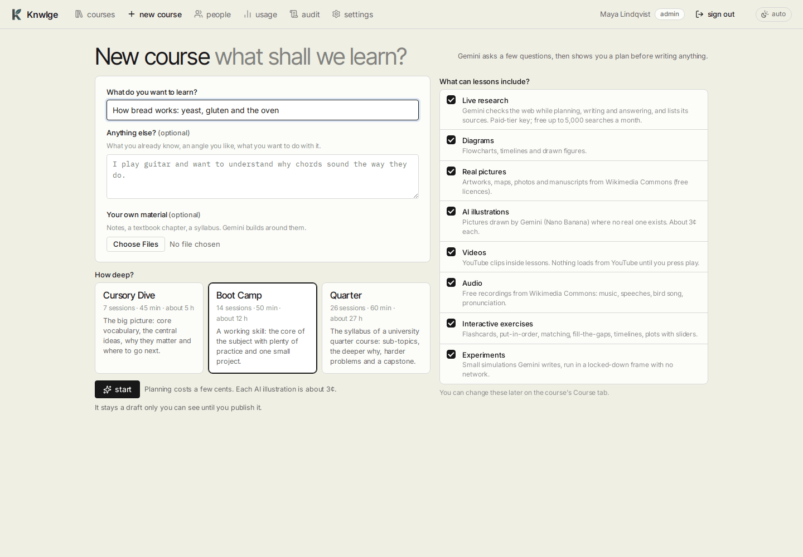
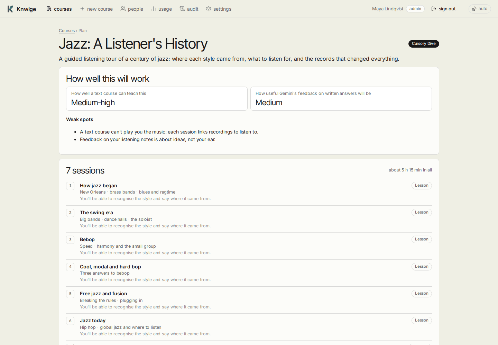

# How to use Knwlge: your first course

[Guide home](README.md) · Next: [Getting started](getting-started.md)

A walk through one course, from an empty Knwlge to a finished first session. Each step links to the page that explains
it in full. Allow about ten minutes of clicking, plus the time it takes Gemini to write.

## Before you start

- Someone has added a Gemini API key under **Settings** (an admin in team mode, you in personal mode). Without one,
  the home page says so and nothing can be made ([Getting started](getting-started.md#adding-the-ai-key)).
- In team mode you need the **author** or **admin** role to make courses. Learners take the courses others publish.

## Step 1: name a subject

1. Click **new course** in the top bar.
2. Say what you'd like to learn, in your own words ("How bread works: yeast, gluten and the oven").
3. Add anything worth knowing in **Anything else?**: what you already know, what you're curious about, what to skip.
4. Pick a **depth**. Boot Camp suits most subjects.
5. Leave the **extras** on (pictures, diagrams, exercises...) unless you'd rather keep it to text. Attach your own
   material (a PDF, notes, photos) if you have some.
6. Click **start**.

More: [Making a course](making-a-course.md).

## Step 2: answer the questions

Within a minute Gemini asks a handful of questions: why the subject, what you already know, what you'd like to be able
to do. Short answers are fine, and **skip** is fine too. Press **plan my course** when you're done.

## Step 3: review the plan

The plan shows the course title, an honest **How well this will work** report (how well a text course can teach this,
and its weak spots), and every session with its topics. Press **looks good, write it**, or write what you'd change
("less history, more practice", "add a session on sourdough") and press **re-plan with these changes**.

## Step 4: study session 1

Session 1 is usually ready a minute or two after you approve. You don't have to wait for the rest. Open it from the
course page and work down the page:

1. Read each short part. Answer its **quick check** as you go.
2. Do the **practice** questions. Wrong is fine: the explanation shows, and the question comes back later as a warm-up.
3. Write the **written exercise** and press **get feedback**.
4. In the **wrap-up**, write two or three sentences from memory, then compare with the key points and **finish
   session**.

More: [Studying](studying.md).

## Step 5: come back whenever

There's no schedule. The home page's **continue** banner takes you to the next session, and each session after the
first starts with a few **warm-up** questions from earlier ones, the ones you missed first.

## Along the way

- Stuck? Press the round chat button in the corner, or right-click a passage and choose **Ask the tutor about this**
  ([The tutor](the-tutor.md)).
- Something you'd explain differently? Right-click the section and edit it, or ask Gemini to rewrite it
  ([Editing a course](editing-courses.md)).
- Curious what it cost? **usage** in the top bar ([Administration](administration.md#usage-and-the-budget)).
