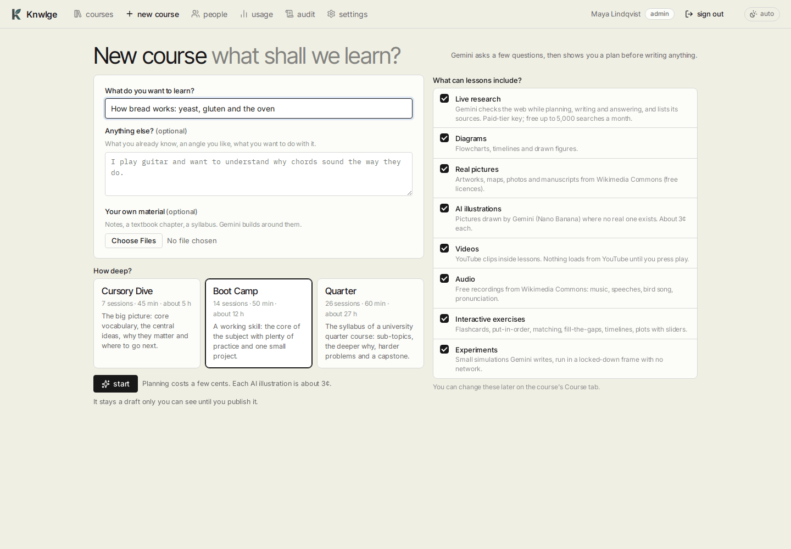
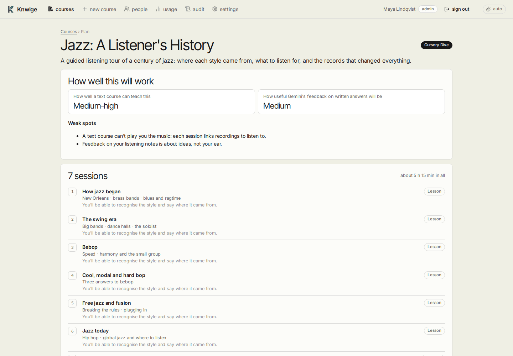
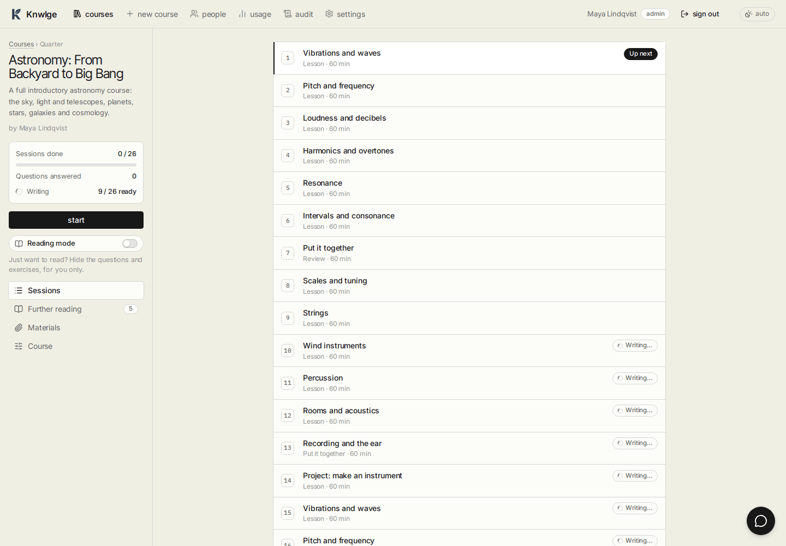

# Making a course

[Guide home](README.md) · Previous: [Getting started](getting-started.md) · Next: [Studying](studying.md)

Authors and admins make courses (in personal mode, you). It takes four steps: the form, a few questions, the plan,
then the writing, which happens in the background.

## The form

| Field | What to put there |
|---|---|
| **What do you want to learn?** | The subject in your own words. Narrow is fine ("the French Revolution, 1789-1794"), broad is fine ("astronomy") |
| **Anything else?** | What you already know, why you're curious, what to leave out, how you like things explained |
| **Your own material** | Up to 12 files of 15 MB each: PDFs, pictures, notes, code. Gemini reads them when planning and writing |
| **How deep?** | One of the three depths below |
| **What can lessons include?** | The extras below, all on by default |

### Depths

| Depth | Sessions | Each | Total | Shape |
|---|---|---|---|---|
| Cursory Dive | 6 + wrap-up | 45 min | ~5 h | The big picture, ending with a "what stuck" quiz |
| Boot Camp | 12 + checkpoint + project | 50 min | ~12 h | A working skill and one small project |
| Quarter | 22 + 2 reviews + checkpoint + capstone | 60 min | ~27 h | Roughly a university intro course's syllabus |

The form shows each depth's number of sessions and hours. Planning costs a few cents; most of a course's cost is
writing its sessions ([Administration](administration.md#usage-and-the-budget)).

### Extras

| Extra | What it adds |
|---|---|
| Live research | Gemini searches the web while planning, writing and answering the tutor, and lists its sources. Needs a paid-tier key |
| Diagrams | Flowcharts, timelines and drawn figures |
| Real pictures | Freely licensed pictures from Wikimedia Commons, downloaded and credited |
| AI illustrations | Pictures drawn by Gemini's image model (about 3¢ each, at most two a session), labelled as AI |
| Videos | YouTube videos, checked to exist; the player loads only when you press play |
| Audio | Recordings from Wikimedia Commons |
| Interactive exercises | Flashcards, put-in-order, matching, fill-the-gaps, timelines, plots with sliders |
| Experiments | Small simulations, run on request in a locked-down frame |

You can change the extras later, on the course's **Course** tab ([Editing a course](editing-courses.md#course-settings)).
Changes apply to sessions written from then on.

## The questions

A minute after **start**, Gemini asks a few questions about you and the subject. Answer briefly, or press **skip the
questions and plan now**. Then press **plan my course**.

## Reviewing the plan

- **How well this will work** rates how well a text course can teach the subject and how good the feedback can be,
  with its **weak spots** (for example, "a text course can't play you the music"). It's meant to be honest.
- **Good to know first** lists anything that helps to know beforehand.
- Then every session, with its kind (lesson, review, checkpoint, project), topics and what you'll be able to do.

Press **looks good, write it**, or type what you'd change and press **re-plan with these changes**. Nothing is written
until you approve.

## While it's being written

Sessions are written in order, each in a minute or two, so you can start session 1 straight away. Each one is:

1. written by Gemini (checkpoints and projects by the top model),
2. checked by Knwlge itself (every multiple-choice answer is one of the options, every number answer is a number...),
3. read through by a second, cheaper model looking for wrong answers and unclear explanations.

A session with major problems is rewritten, at most twice. Anything the second reader still flags shows at the top of
the session for its author. The **further reading** list is made last, and each suggestion is checked to exist
before you see it.

The top bar shows **Working (n to go)** while anything is being made. If a step fails, the course page says so and
offers **try again**. If the monthly budget is reached, work pauses until next month or until an admin raises it
([Administration](administration.md#usage-and-the-budget)).

## In team mode: drafts and publishing

A new course is a **draft**: only its author and admins see it. When it's ready, open its **Course** tab and publish
it; everyone can then take it. **back to draft** hides it again; learners' progress is kept. Learners who open a
course that's still being prepared see "This course is still being prepared".
