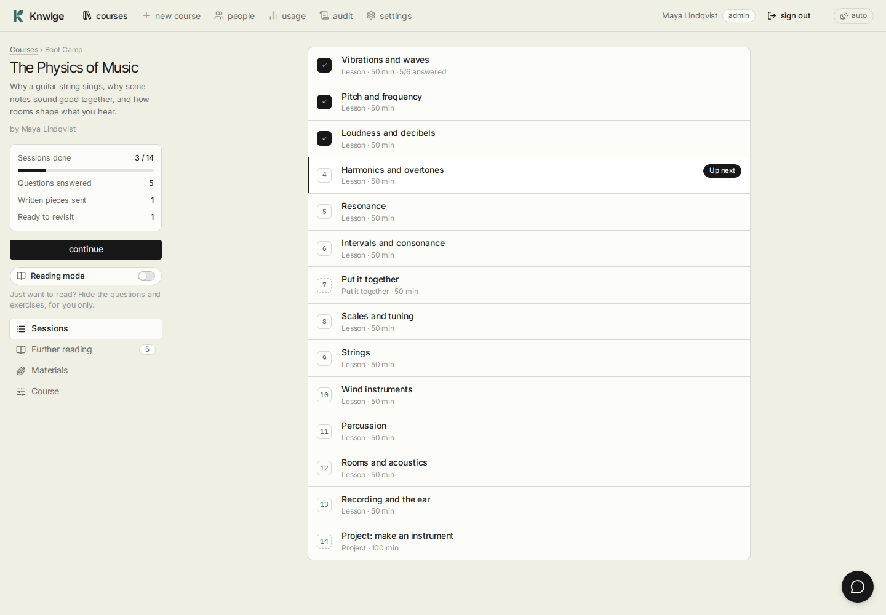
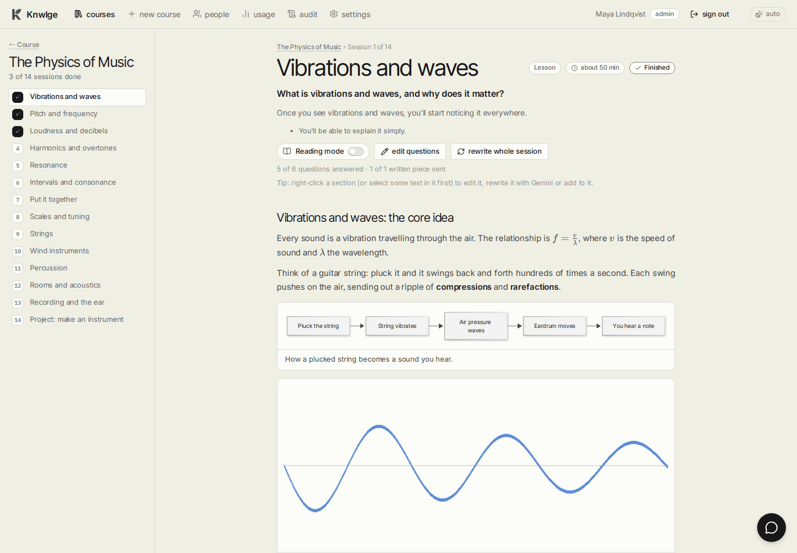
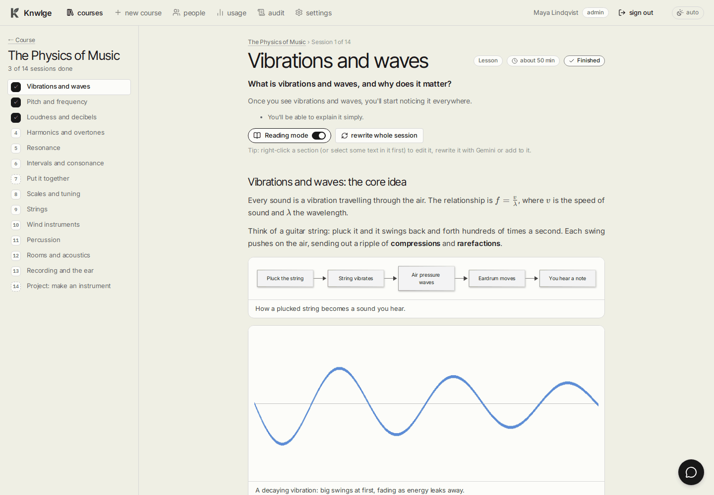
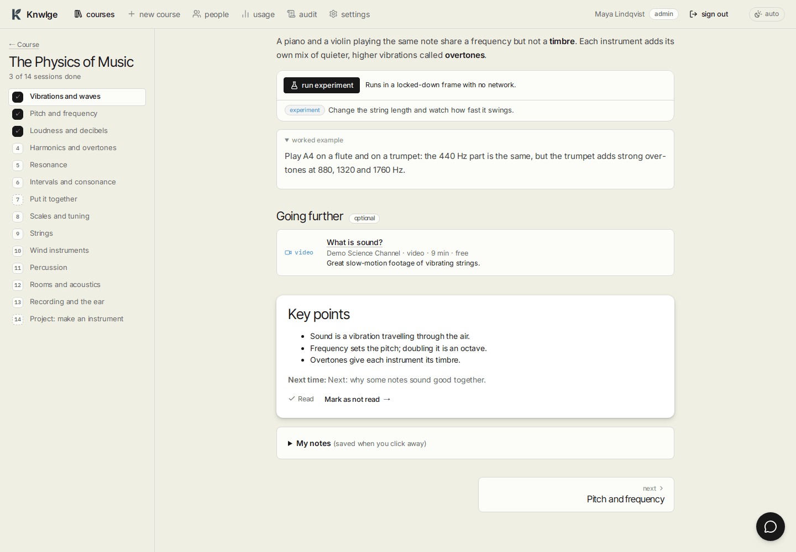
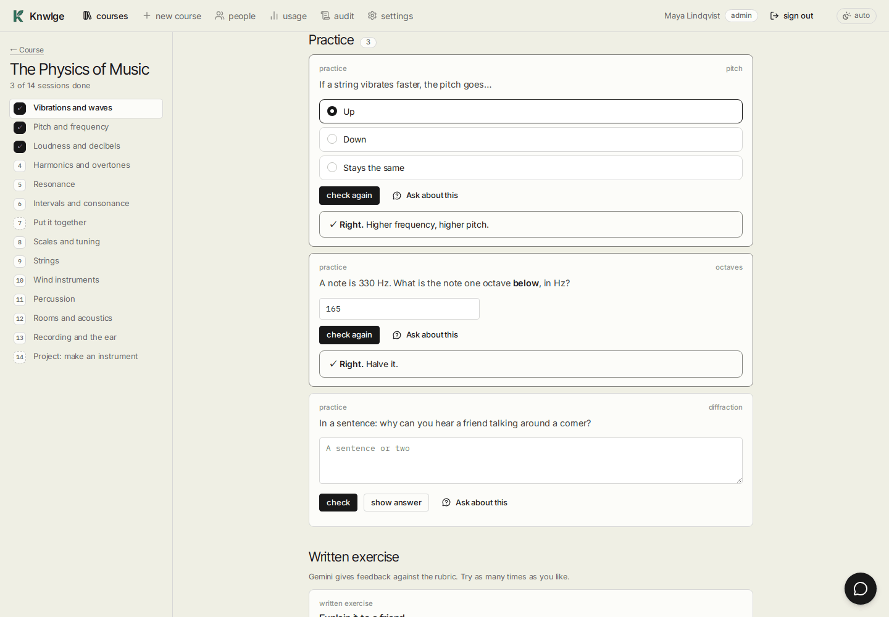
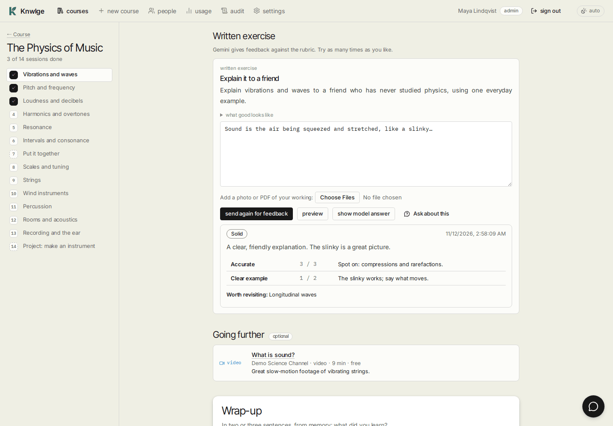
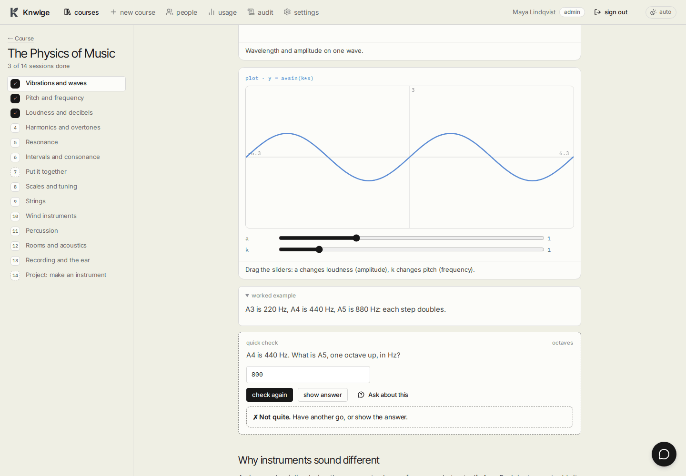
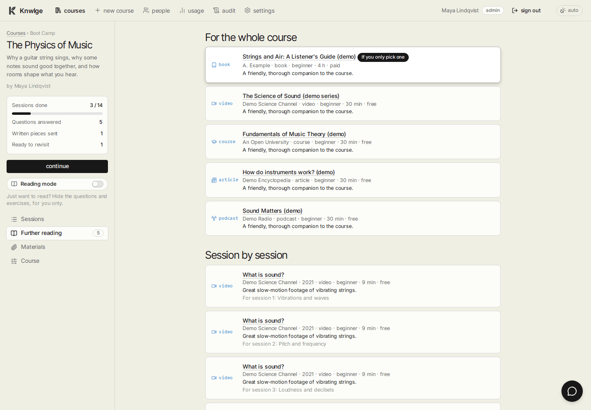

# Studying

[Guide home](README.md) · Previous: [Making a course](making-a-course.md) · Next: [The tutor](the-tutor.md)

## The course page

On the left: the course, how many sessions you've finished, how many questions you've answered, and how many are
**ready to revisit** (they come back in the next warm-up), then **continue**, which opens the next unfinished session.
There's no score: Knwlge shows what you've done and what's worth another look, never a grade. The tabs below it:

| Tab | What's there |
|---|---|
| Sessions | Every session, with its kind, length and whether you've finished it. All open from the start: skip around freely |
| Further reading | Books, videos, courses and podcasts for the whole course, then per session ([below](#further-reading)) |
| Materials | Your own files and notes for this course (authors and admins) |
| Course | Name, extras, publishing, export and delete (authors and admins; [Editing a course](editing-courses.md#course-settings)) |

## A session

The outline stays on the left; the session scrolls on the right, in one centred column. From top to bottom:

1. **The goal** (the one question this session answers) and a short hook.
2. **Warm-up** (from session 2 on): three or four questions from earlier sessions. Ones you missed come first, then
   ones due for review, then older ones you haven't seen in a while. Recalling is what makes it stick.
3. **Lesson parts**: short sections of reading (about six minutes each), each with a worked example, any pictures,
   diagrams or recordings, and a **quick check** or two.
4. **Practice**: questions that go from guided to independent, some mixing in earlier sessions.
5. **Written exercise**: a paragraph or a worked problem, with feedback.
6. **Going further** (optional reading for this session) and **Sources Gemini looked at** (with live research).
7. **Wrap-up**: summarise from memory, then compare.
8. **My notes**, and links to the previous and next session.

## Reading mode

Sometimes you just want to read. Switch on **Reading mode** (on the course page, or at the top of any session) and the
course becomes pure reading **for you**:

- **Hidden:** quick checks, practice, the written exercise, warm-ups, and the quiz-like widgets (flashcards,
  put-in-order, matching, fill-the-gaps).
- **Kept:** the lessons, worked examples, pictures, diagrams, video and audio, plots, timelines and experiments, the
  tutor and further reading.
- **The wrap-up** shows the key points straight away; **mark as read** moves you on.
- **Progress** counts sessions read instead of questions answered.
- **Projects** say what the project is and that you can switch Reading mode off to do it.

Nothing is deleted: the questions are still written for every course, and switching Reading mode off brings them
back, with any answers you gave before. It's per person and per course, so in team mode one person can read a course
while another works through its exercises.

## Questions

- **Multiple choice and numbers** are marked on the spot. A number counts if it's close enough (each question has its
  own tolerance).
- **Short answers** are marked by Gemini against a model answer, in a few seconds.
- Wrong answers show the explanation. Try again as often as you like with **check again**.
- **Show answer** reveals the answer without trying. That's allowed; it's your course.
- Every question you answer goes into your review queue: right answers come back after a growing gap (2 days, then
  5, then about 12...), missed ones in the very next warm-up.

## Written work and feedback

Write your answer (you can attach a photo or PDF of handwritten work) and press **get feedback**. Gemini comments on
each line of the rubric; Knwlge adds up the points itself, each line capped at its maximum, so the score can't be
talked up. Change your answer and **send again for feedback** as often as you like. **Show model answer** reveals a
full worked answer.

## Interactive parts

Plots with sliders, flashcards, put-in-order, matching, fill-the-gaps and timelines work right in the page.
**Experiments** (small simulations) start only when you press **run experiment**, inside a locked-down frame that can't reach the
network or the rest of the app. Videos load from YouTube only when you press play.

## Wrap-up and finishing

Write two or three sentences from memory about what you learned, press **compare with the key points**, then
**finish session**. Knwlge moves you on to the next one. **Mark as not finished** undoes it.

## Further reading

Every suggestion has been checked: books on Open Library, videos on YouTube, everything else by loading the page.
Ones that can't be found are dropped, so the list is shorter than what Gemini first suggested, but real. Each says
what it is, how long it takes, whether it's free, and why it's worth your time.

## Progress is yours

In team mode everyone has their own answers, feedback, warm-ups, notes and progress. Finishing a session, or getting
something wrong, only changes your own.
