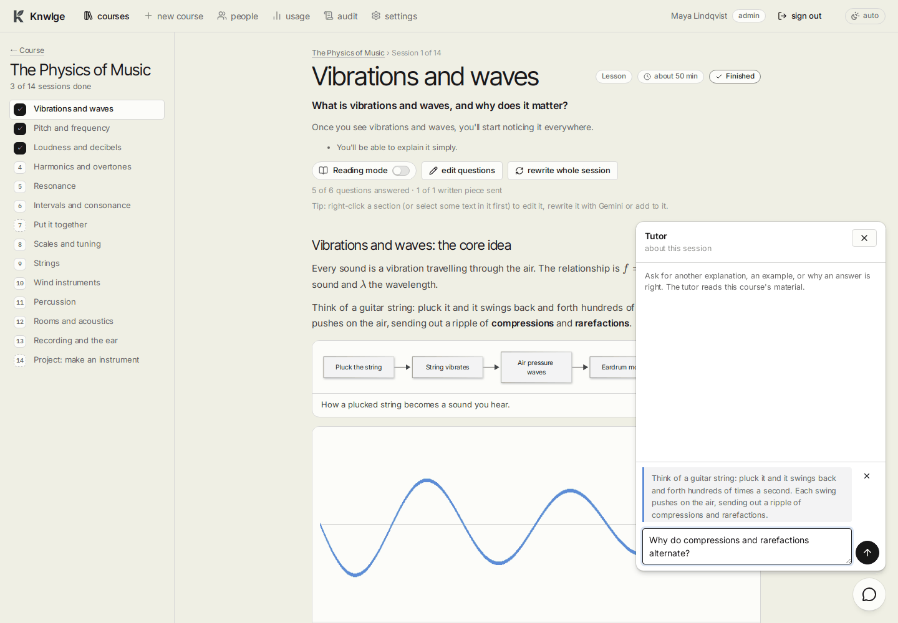

# The tutor

[Guide home](README.md) · Previous: [Studying](studying.md) · Next: [Editing a course](editing-courses.md)

A chat with Gemini that knows the course: ask for another explanation, an example, why an answer is right, or how two
ideas connect. Everyone can use it, learners included.

## Opening it

- **The bubble.** On every course and session page a round chat button sits in the bottom-right corner. Click it to
  open the chat; click it again (or press **Esc**, or **✕**) to close it.
- **About a question.** Under any question, **Ask about this** opens the chat about that question. The tutor then also
  sees the question, its answer and explanation, and your latest answer with the feedback you got. **back to this
  session** returns to the session's chat.
- **About a passage.** Select some text in a lesson, right-click it and choose **Ask the tutor about this**. The passage
  is quoted above the input box; type your question and send. Without a selection the same menu item asks about the
  whole section. **✕** next to the quote leaves it out.

**Enter** sends; **Shift+Enter** starts a new line. While the tutor is thinking, three dots show. If you close the
window before the answer arrives, a dot lights up on the bubble when it's ready.

## What it knows

| Asked from | What the tutor reads |
|---|---|
| A course page | The course plan: title, summary and every session's topics |
| A session | The whole session: goal and every lesson part with its worked example |
| A question | The session, plus the question, its answer, explanation and rubric, and your latest attempt |

It also reads the course's own materials (your uploads), and with **Live research** on it searches the web and lists
the sources it looked at under its answer.

## Good to know

- Each conversation (course, session or question) is kept, so you can come back to it. It's yours: in team mode
  nobody else sees your chats.
- It will give you an answer if you ask (it's self-paced learning), but it explains the reasoning.
- If something in the material looks wrong, it's told to say so.
- Each question is one Gemini call, counted in the usage and the budget.
